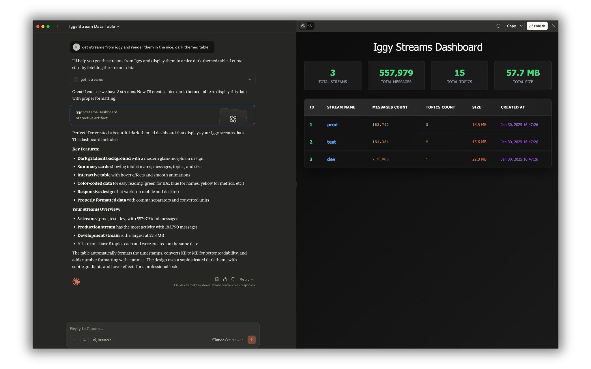

# Apache Iggy MCP Server

The [Model Context Protocol](https://modelcontextprotocol.io) (MCP) is an open protocol that standardizes how applications provide context to LLMs. The Apache Iggy MCP Server is an implementation of the MCP protocol for the message streaming infrastructure.

Start an Iggy broker from the same checkout first. For a development broker started with `--with-default-root-credentials`, run from the repository root:

```sh
IGGY_MCP_IGGY_USERNAME=iggy IGGY_MCP_IGGY_PASSWORD=iggy cargo run --bin iggy-mcp
```

Use the credentials or PAT of your existing broker when connecting to another installation.

The [docker image](https://hub.docker.com/r/apache/iggy-mcp) is available, and can be fetched via `docker pull apache/iggy-mcp:edge`.

The minimal viable configuration requires at least the Iggy credentials, to create the connection with the running Iggy server using TCP with which the MCP server will communicate. You can choose between HTTP (the default) and STDIO transports (e.g. for the local usage with tools such as [Claude Desktop](https://claude.ai/download) choose `stdio`).

```toml
transport = "stdio" # http or stdio are supported

[iggy]
address = "localhost:8090" # TCP address of the Iggy server
username = "iggy"
password = "iggy"
# token = "secret" # Personal Access Token (PAT) can be used instead of username and password
# consumer = "iggy-mcp" # Optional consumer name

[iggy.tls] # Optional TLS configuration for Iggy TCP connection
enabled = false
ca_file = "core/certs/iggy_cert.pem"
domain = "" # Optional domain for TLS connection

[http] # Optional HTTP API configuration
address = "127.0.0.1:8082" # A non-loopback address requires auth_token
path = "/mcp"
auth_token = "" # Bearer token MCP clients must send, a literal or file:/path/to/token
allowed_hosts = ["localhost", "127.0.0.1", "::1"] # Host header names the server answers

[http.cors] # Optional CORS configuration for HTTP API
enabled = false
allowed_methods = ["GET", "POST", "PUT", "DELETE"]
allowed_origins = [] # Browser origins such as "http://localhost:5173", "*" requires auth_token
allowed_headers = ["content-type"]
exposed_headers = [""]
allow_credentials = false
allow_private_network = false

[http.tls] # Optional TLS configuration for HTTP API
enabled = false
cert_file = "core/certs/iggy_cert.pem"
key_file = "core/certs/iggy_key.pem"

[permissions]
create = true
read = true
update = true
delete = true
admin = false # Users, personal access tokens, permissions, passwords and snapshots
```

The configuration file must use TOML. The default path is `core/ai/mcp/config.toml`, relative to the working directory; override it with `IGGY_MCP_CONFIG_PATH`. Embedded defaults are loaded first, then the file if present, then environment overrides such as `IGGY_MCP_IGGY_USERNAME` and `IGGY_MCP_HTTP_ADDRESS`. Nested settings also use underscores, for example `IGGY_MCP_IGGY_TLS_ENABLED`.

Set `IGGY_MCP_ENV_PATH` to load a particular dotenv file. Otherwise `.env` is searched for in the current directory and its parents. Existing environment variables take precedence over dotenv values.

Run `iggy-mcp --list-config-env-vars` to print the supported configuration environment variables and exit before loading dotenv or configuration files or creating the runtime.

A non-empty `iggy.token` takes precedence over username and password. It accepts a literal PAT or a `file:` reference such as `file:/run/secrets/iggy_pat`; file contents are trimmed and a leading `~/` expands to the home directory.

`iggy.consumer` names the consumer that `get_consumer_offset`, `store_consumer_offset`, `delete_consumer_offset` and auto-committing `poll_messages` act on. These tools take no consumer argument, so clients that need separate offsets need separate MCP server instances, each with its own `consumer`.

`iggy-mcp` rejects unknown command-line arguments with exit code 2. Keep the client or container `args` list empty unless it contains a supported flag.

Set `command` to the absolute path of the built executable. This Claude Desktop example uses the development broker credentials:

```json
{
  "mcpServers": {
    "iggy": {
      "command": "/path/to/iggy-mcp",
      "args": [],
      "env": {
        "IGGY_MCP_TRANSPORT": "stdio",
        "IGGY_MCP_IGGY_ADDRESS": "localhost:8090",
        "IGGY_MCP_IGGY_USERNAME": "iggy",
        "IGGY_MCP_IGGY_PASSWORD": "iggy"
      }
    }
  }
}
```

**Remember to use the appropriate Iggy account credentials for your environment** (e.g. create the user with read-only permissions to avoid modifying the data). On top of this, you can also configure the `permissions` for the MCP server to control which operations are allowed (this will be checked first, before forwarding the actual request to the Iggy server).

## HTTP access

Anyone who can call the HTTP transport acts as the configured Iggy account. The default address `127.0.0.1:8082` accepts local connections only.

Set `http.auth_token` to require `Authorization: Bearer <token>` on every MCP request. It takes a literal token or a `file:` reference, read the same way as `iggy.token`. A request without exactly one matching header gets `401 Unauthorized`. The `/` and `/health` routes stay open for health checks. Use a long random token, and TLS when the server is reachable from other hosts.

The server refuses to start without `http.auth_token` when it binds a non-loopback address such as `0.0.0.0:8082`, or when CORS allows every origin (`*`).

`http.allowed_hosts` lists the `Host` header names the server answers, which keeps a web page from reaching a local server through DNS rebinding. The default accepts loopback names only, so add the host name remote clients use.

A request whose `Origin` header is not listed in `http.cors.allowed_origins` gets `403 Forbidden`. With CORS disabled, every request that carries an `Origin` header is refused.



## Tool permissions

Each tool checks these MCP permissions before forwarding the request. The broker also enforces the authenticated Iggy account's permissions.

| Permission | Tools |
| --- | --- |
| `read` | `ping`, `get_cluster_metadata`, `get_stream`, `get_streams`, `get_topic`, `get_topics`, `poll_messages`, `get_stats`, `get_me`, `get_client`, `get_clients`, `snapshot`, `get_consumer_group`, `get_consumer_groups`, `get_consumer_offset`, `get_personal_access_tokens`, `get_user`, `get_users` |
| `create` | `create_stream`, `create_topic`, `create_partitions`, `send_messages`, `create_consumer_group`, `create_personal_access_token`, `create_user` |
| `update` | `update_stream`, `update_topic`, `store_consumer_offset`, `update_user`, `update_permissions`, `change_password` |
| `delete` | `delete_stream`, `delete_topic`, `delete_partitions`, `delete_segments`, `delete_consumer_group`, `delete_consumer_offset`, `delete_personal_access_token`, `delete_user` |

`poll_messages` additionally requires `update` when `auto_commit = true` or `strategy = "next"`. The `next` strategy enables auto-commit even when `auto_commit` is omitted or false. For read-only polling, use `offset`, `first`, `last`, or `timestamp` with auto-commit disabled.

The administration tools `get_personal_access_tokens`, `create_personal_access_token`, `delete_personal_access_token`, `get_users`, `get_user`, `create_user`, `update_user`, `delete_user`, `update_permissions`, `change_password` and `snapshot` also require `admin`, which is off by default. They let an agent mint credentials, lock out users or read server diagnostics, so enable `admin` only for a server whose agents administer Iggy.

`send_messages` takes UTF-8 payloads, and `poll_messages` returns payloads base64 encoded. A batch with an invalid message, such as an empty payload, is refused and nothing is sent.

## Recovering uncertain writes

Every error of a call that reached Iggy carries `data.outcome`. `uncertain` means
the call was sent and may or may not have been applied. `blocked` means the call
was not sent, because an earlier operation with an unknown outcome holds its
lane. `failed` means nothing was applied. An `uncertain` error without
`data.operation_id` cannot be settled with `resolve_operation`, so read the state
the call changes before retrying it.

Write errors can include `data.operation_id` as a decimal string. Keep this value
exactly as returned. `resolve_operation` retries the retained original operation
with its original identity; success proves it committed and releases its lane.
It does not reconstruct the original response body. If the result is still
uncertain, the operation remains available for another resolve.

`abandon_operation` explicitly releases local recovery state. It does not undo
the write or establish whether it committed. Retrying the business action after
abandoning it can duplicate an earlier effect. Both tools take
`{"operation_id": "123"}` and require at least one of the `create`, `update`, or
`delete` MCP permissions. A process restart loses this local recovery state.

A poll with auto-commit (`auto_commit = true` or `strategy = "next"`) stores the
consumer offset, so a lost reply leaves it uncertain too. Its error carries
`data.operation_id`, and later polls and offset writes of that partition fail
until `abandon_operation` releases it. `resolve_operation` cannot prove such a
poll and keeps it uncertain. After the abandon, the stored offset stays unknown.

## Systemd integration

Build with the `systemd` feature to enable systemd readiness and watchdog notifications:

```sh
cargo build --bin iggy-mcp --release --features iggy-mcp/systemd
```

Readiness is sent after the HTTP listener starts or the stdio session initializes. The watchdog sends keep-alive notifications at half the interval supplied by systemd. SIGINT, SIGTERM, and stdio client disconnect trigger shutdown and a stopping notification.

## Logging

Both transports log at `INFO` unless `RUST_LOG` sets another level. The stdio transport writes logs to stderr. At `debug`, every request and reply is logged in full, so keep production at `INFO`.

## Telemetry

The MCP server supports OpenTelemetry for logs and traces. To enable telemetry, add the following configuration:

```toml
[telemetry]
enabled = true
service_name = "iggy-mcp"

[telemetry.logs]
transport = "grpc" # Options: "grpc", "http"
endpoint = "http://localhost:4317"

[telemetry.traces]
transport = "grpc" # Options: "grpc", "http"
endpoint = "http://localhost:4317"
```

For HTTP export, set `transport = "http"` and use complete signal URLs: `http://localhost:4318/v1/logs` for logs and `http://localhost:4318/v1/traces` for traces. The MCP server does not append those paths.

Shutdown flushes pending logs and spans before stopping the async runtime.
