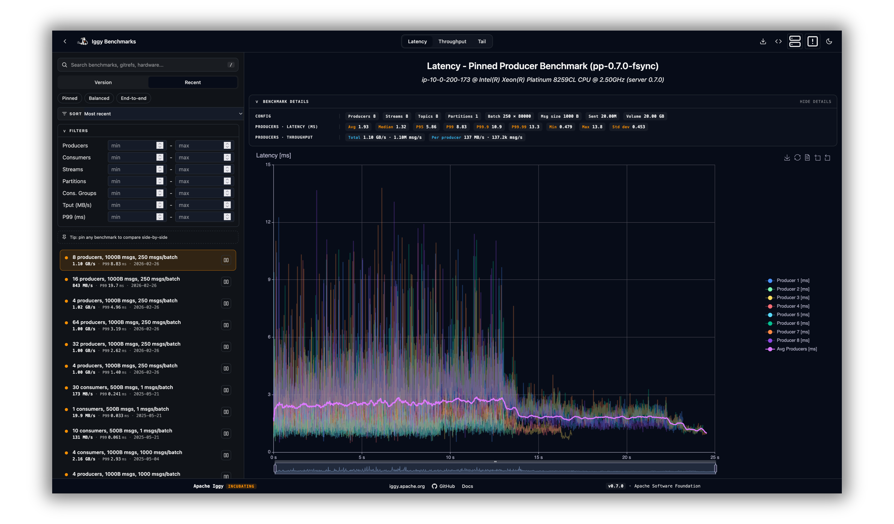

# Apache Iggy Benchmarks Dashboard

A web dashboard for Apache Iggy benchmark results. It reads the reports that `iggy-bench` saves. From them it
shows which runs are comparable, how each release did, and what changed between two runs or two versions.

## Features

- The Overview (`/`) shows the headline workloads from `dashboard.toml`: the latest release's numbers, the
  trend across releases, and the change in newer builds.
- Explore (`/benchmarks`) lists every run, with search and filters for machine, version, kind, topology,
  durability and message size.
- The run page (`/benchmarks/{uuid}`) shows one run: headline numbers against the previous version, charts
  over the run, every percentile, history across versions, the command to reproduce it, and its files.
- Compare (`/compare` and `/compare/releases`) puts two or three runs side by side, or two versions across
  an official suite.
- Methodology (`/methodology`) explains how to run `iggy-bench`, and what every number, threshold and badge
  means.

A run's charts can also be embedded in another page as an iframe or a PNG. On a phone, tables turn into
labeled blocks.



## Project Structure

The dashboard is three crates in the Iggy workspace:

- `frontend/`: the Yew web application, built with Trunk
- `server/`: the Actix-web server. It reads the results directory, serves the JSON API, the embed pages and
  the PNG charts, and hosts the built frontend
- `shared/`: code that the server and the frontend both use, such as the run summary, the workload key, the
  delta rule and the configuration types

## API Endpoints

The server provides the following HTTP endpoints:

### Health Check

- `GET /health`
  - Check server health status
  - Response: `{"status": "healthy"}`

### Benchmarks

- `GET /api/benchmarks`
  - List all runs as summaries, newest first: identity, the hardware of the machine that ran the bench, workload key, badges, and the comparable metrics of each actor group
  - Response: Array of run summaries

- `GET /api/config`
  - Get the dashboard configuration file: official suites, headline workloads, and thresholds
  - Response: Configuration JSON

### Benchmark Reports

- `GET /api/benchmark/full/{unique_id}`
  - Get full benchmark report
  - Parameters:
    - `unique_id`: UUID of the benchmark
  - Response: Complete benchmark report JSON

- `GET /api/benchmark/light/{unique_id}`
  - Get lightweight benchmark report
  - Parameters:
    - `unique_id`: UUID of the benchmark
  - Response: Simplified benchmark report JSON

- `GET /api/benchmark/series/{unique_id}?metric={metric}&scope={scope}`
  - Get the time series of a run for charts, with at most 3000 points per series (LTTB downsampling)
  - The server builds the series on the first request and keeps them in a bounded memory cache until the results directory reloads
  - Parameters:
    - `unique_id`: UUID of the benchmark
    - `metric`: `latency` (average latency of each sampling window, in ms) or `throughput` (MB/s)
    - `scope`: `group` (one series per actor group, with the total MB/s or the average latency of its actors) or `actors` (one series per actor)
  - Response: the metric, its unit, and the series. Each series has a `source`, for example `{"group": "producers"}` or `{"actor": {"kind": "consumer", "id": 3}}`, and its `time_s` and `value` points

### Test Artifacts

- `GET /api/artifacts/{uuid}`
  - Download test artifacts for a benchmark
  - Parameters:
    - `uuid`: UUID of the benchmark
  - Response: ZIP archive containing test artifacts, built on the first request and then served from `--cache-dir`

### Embedded Charts

- `GET /embed/{uuid}?type={type}&theme={theme}&action={action}`
  - Get a page with the interactive chart of a run, for an iframe
  - Parameters:
    - `uuid`: UUID of the benchmark
    - `type`: `latency` (default), `throughput`, or `distribution`
    - `theme`: `dark` (default) or `light`
    - `action`: optional, `download` gives a page that saves the chart as a PNG file in the browser
  - Response: HTML page

- `GET /embed/{uuid}/chart.png?type={type}&theme={theme}&width={width}&height={height}&legend={legend}`
  - Get the chart of a run as an image, rendered on the server
  - Parameters:
    - `uuid`: UUID of the benchmark
    - `type`: `latency` (default), `throughput`, or `distribution`
    - `theme`: `dark` (default), `light`, `dark_nobg`, or `light_nobg` (transparent background)
    - `width`, `height`: image size in pixels, from 1 to 4096 (default 1600 x 1200)
    - `legend`: `true` (default) or `false`
  - Response: PNG image. At the default size it is built on the first request and then served from
    `--cache-dir`. Other sizes are built on every request.

`/health` and the `/api` endpoints return JSON, except `/api/artifacts/{uuid}`, which returns a ZIP file. The embed
endpoints return HTML or PNG. All of them use standard HTTP status codes:

- 200: Success
- 400: Invalid parameter
- 404: Resource not found
- 500: Server error

An unknown `/api` path returns 404 with a JSON error. Every other path serves the frontend from `frontend/dist`.
A page path with no file there gets `index.html` with 200, so the frontend's page links work.

## Prerequisites

- Rust toolchain (latest stable)

  ```bash
  rustup default stable
  ```

- WebAssembly target

  ```bash
  rustup target add wasm32-unknown-unknown
  ```

- Trunk (for frontend development)

  ```bash
  cargo install trunk
  ```

## Development Setup

1. Clone the repository:

   ```bash
   git clone <repository-url>
   ```

2. Run the development script:

   ```bash
   ./scripts/dashboard/run_dev.sh
   ```

   This will start both the frontend development server and the backend server.

## Running the Application

### Production Mode

1. Build the release version:

   ```bash
   ./scripts/dashboard/build_release.sh
   ```

2. Start the server from `core/bench/dashboard`. The server reads `dashboard.toml` and `frontend/dist` from its
   working directory:

   ```bash
   cd core/bench/dashboard
   ../../../target/release/iggy-bench-dashboard-server --host 127.0.0.1 --port 8061 \
       --results-dir ../../../performance_results
   ```

### Development Mode

Run the development script from root of `apache/iggy` repository to start both the frontend and backend servers:

```bash
./scripts/dashboard/run_dev.sh
```

This will start:

- Frontend development server on port 8060, which proxies `/api`, `/embed` and `/health` to the backend
- Backend API server on port 8061

Access the development version at <http://localhost:8060>

## Running with Docker

The [docker image](https://hub.docker.com/r/apache/iggy-bench-dashboard) is available, and can be fetched via `docker pull apache/iggy-bench-dashboard`.

### Building the Image

Call this from the root of the repository:

```bash
docker build -t iggy-bench-dashboard -f core/bench/dashboard/server/Dockerfile .
```

### Running the Container

First, check that your performance results directory exists and has proper permissions:

  ```bash
  mkdir -p performance_results
  chmod 755 performance_results
  ```

Basic usage (recommended). The server listens on port 80 in the container:

  ```bash
  docker run -p 8061:80 \
     -v "$(pwd)/performance_results:/data/performance_results" \
     --user "$(id -u):$(id -g)" \
     apache/iggy-bench-dashboard
  ```

With custom configuration:

  ```bash
  docker run -p 8061:8061 \
        -v "$(pwd)/performance_results:/data/performance_results" \
        --user "$(id -u):$(id -g)" \
        -e HOST=0.0.0.0 \
        -e PORT=8061 \
        -e RESULTS_DIR=/data/performance_results \
        apache/iggy-bench-dashboard
  ```

With your own dashboard configuration and a cache directory that persists between restarts:

  ```bash
  mkdir -p dashboard_cache
  docker run -p 8061:80 \
        -v "$(pwd)/performance_results:/data/performance_results" \
        -v "$(pwd)/dashboard.toml:/config/dashboard.toml:ro" \
        -v "$(pwd)/dashboard_cache:/cache" \
        --user "$(id -u):$(id -g)" \
        -e CONFIG=/config/dashboard.toml \
        -e CACHE_DIR=/cache \
        apache/iggy-bench-dashboard
  ```

Using a named volume:

  ```bash
  # Create a named volume
  docker volume create iggy-results

  # Run with named volume
  docker run -p 8061:80 \
     -v iggy-results:/data/performance_results \
     apache/iggy-bench-dashboard
  ```

## Configuration

### Docker Configuration

#### Environment Variables

| Variable      | Default                     | Description                                                         |
| ------------- | --------------------------- | ------------------------------------------------------------------- |
| `HOST`        | `0.0.0.0`                   | Server host address                                                 |
| `PORT`        | `80`                        | Server port                                                         |
| `RESULTS_DIR` | `/data/performance_results` | Directory for performance results                                   |
| `CONFIG`      | `/app/dashboard.toml`       | Dashboard configuration file. The image holds the official one      |
| `CACHE_DIR`   | not set                     | Directory for cached PNG files and artifact zips. See `--cache-dir` |

#### Volume Permissions

The container is configured to run as a non-root user for security. When you mount a local directory:

1. Use the `--user` flag with your local user ID to get the correct file permissions
2. Make sure your local directory has the correct permissions (755)
3. If using a named volume, the container will handle permissions automatically

### Application Configuration

#### Server Settings

The server can be configured using command-line arguments:

```bash
iggy-bench-dashboard-server [OPTIONS]

Options:
      --host <HOST>                  Server host address [default: 127.0.0.1]
      --port <PORT>                  Server port [default: 8061]
      --results-dir <RESULTS_DIR>    Directory containing performance results [default: ./performance_results]
      --log-level <LOG_LEVEL>        Log level (trace, debug, info, warn, error) [default: info]
      --cors-origins <CORS_ORIGINS>  Allowed CORS origins (comma-separated) [default: *]
      --cache-dir <CACHE_DIR>        Directory for cached PNG files and artifact zips [default: /tmp/iggy-bench-dashboard]
      --config <CONFIG>              Dashboard configuration file: official suites, headline workloads, and thresholds [default: dashboard.toml]
  -h, --help                         Print help
  -V, --version                      Print version
```

The server only reads `--results-dir`. It writes the files it generates to `--cache-dir`: chart PNG files of
the default size for `/embed/{uuid}/chart.png` under `embed/` and artifact zips for `/api/artifacts/{uuid}`
under `artifacts/`. Each file is built on the first request and reused later. When a file in a run directory
changes or is removed, the server rebuilds that run's artifact zip. To rebuild the PNG files, delete the
directory. The default is `iggy-bench-dashboard` in the system temp directory (`$TMPDIR`, usually `/tmp`). If
`--cache-dir` is inside `--results-dir`, the server does not start.

The server reads `--config` at start. The default is `dashboard.toml` in the working directory, and this
directory holds the file for the official AWS suites. If a run's `suite` label is in `[[suites]]`, the run is
official. If the file is missing or invalid, the server does not start.

### Environment Variables for Development

For development, you can also use environment variables:

- `RUST_LOG`: Control log level and filters
- `RUST_BACKTRACE`: Enable backtraces (1 = enabled, full = full backtraces)

## License

Apache-2.0
