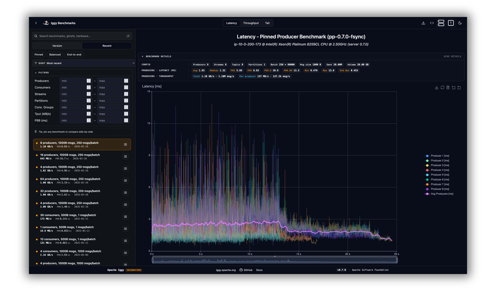

# Apache Iggy Benchmarks Dashboard

A web dashboard for Apache Iggy benchmark results. It reads the reports that `iggy-bench` saves. From them it
shows which runs are comparable, how each release did, and what changed between two runs or two versions. It can
also show OpenMessaging Benchmark (OMB) results of Iggy, in a separate part of the site.

## Features

- The Overview (`/`) shows the headline workloads from `dashboard.toml`: the latest release's numbers, the
  trend across releases, and the change in newer builds.
- Explore (`/explore`) lists every run, with search and filters for machine, version, kind, topology,
  durability and message size.
- The run page (`/runs/{uuid}`) shows one run: headline numbers against the previous version, latency
  window by window, every percentile, throughput with the rates of the whole run, history across versions,
  the command to reproduce it, and its files. An old run link, `/benchmarks/{uuid}`, moves to this page.
- Compare (`/compare?runs={uuid},{uuid}` and `/compare/releases`) puts two or three runs side by side, or
  two versions across an official suite. The first run in `runs` is the baseline.
- If the server has an OMB results directory, OMB (`/omb`) lists its OpenMessaging Benchmark runs. The OMB
  pages use the same paths under `/omb`: `/omb/runs/{id}` for a run and `/omb/compare?runs={id},{id}` to
  compare runs. See [OpenMessaging Benchmark Results](#openmessaging-benchmark-results).
- Methodology (`/methodology`) explains how to run `iggy-bench`, and what every number, threshold and badge
  means.

A run's charts can also be embedded in another page as an iframe or a PNG. On a run page, the embed button in
the corner of a chart opens a dialog with that chart. The Embed card in the Artifacts section opens the same
dialog. In the dialog, you pick the chart, the format, the theme and the size. The dialog shows a preview from
the same link and gives the code to copy. On a phone, tables turn into labeled blocks.



## Project Structure

The dashboard is three crates in the Iggy workspace:

- `frontend/`: the Yew web application, built with Trunk
- `server/`: the Actix-web server. It reads the results directory and the optional OMB results directory,
  serves the JSON API, the embed pages and the PNG charts, and hosts the built frontend
- `shared/`: code that the server and the frontend both use, such as the run summary, the workload key, the
  delta rule and the configuration types

## API Endpoints

The server provides the following HTTP endpoints:

### Health Check

- `GET /health`
  - Check server health status
  - Response: `{"status": "healthy"}`

### Benchmarks

- `GET /api/benchmarks`
  - List all runs as summaries, newest first: identity, the hardware of the machine that ran the bench, workload key, badges, and the comparable metrics of each actor group
  - Response: Array of run summaries

- `GET /api/config`
  - Get the dashboard configuration file: official suites, headline workloads, and thresholds
  - Response: Configuration JSON

- `GET /api/github/stars`
  - Get the star count of the Apache Iggy repository for the top bar. The server asks `api.github.com` when it
    starts and then every hour, so the pages make no request to GitHub. A failed request keeps the last count
  - Response: `{"stars": 5123}`, or `{"stars": null}` before the first answer from GitHub

### Benchmark Reports

- `GET /api/benchmark/full/{unique_id}`
  - Get full benchmark report
  - Parameters:
    - `unique_id`: UUID of the benchmark
  - Response: Complete benchmark report JSON

- `GET /api/benchmark/light/{unique_id}`
  - Get lightweight benchmark report
  - Parameters:
    - `unique_id`: UUID of the benchmark
  - Response: Simplified benchmark report JSON

- `GET /api/benchmark/series/{unique_id}?metric={metric}&scope={scope}`
  - Get the time series of a run for charts, with at most 3000 points per series (LTTB downsampling)
  - The server builds the series on the first request and keeps them in a bounded memory cache until the results directory reloads
  - Parameters:
    - `unique_id`: UUID of the benchmark
    - `metric`: `latency` (average latency of each sampling window, in ms) or `throughput` (MB/s)
    - `scope`: `group` (one series per actor group, with the total MB/s or the average latency of its actors) or `actors` (one series per actor)
  - Response: the metric, its unit, and the series. Each series has a `source`, for example `{"group": "producers"}` or `{"actor": {"kind": "consumer", "id": 3}}`, and its `time_s` and `value` points

### Test Artifacts

- `GET /api/artifacts/{uuid}`
  - Download test artifacts for a benchmark
  - Parameters:
    - `uuid`: UUID of the benchmark
  - Response: ZIP archive containing test artifacts, built on the first request and then served from `--cache-dir`

### Embedded Charts

The subtext of an embedded chart gives each actor group's throughput as the dashboard pages do: the user data
of the group divided by the run time of its slowest actor. `Avg Per Producer` (or consumer) is that rate divided
by the number of actors in the group. The `iggy-bench` HTML charts and console output still add up the actors'
own rates.

The server keeps every embed page and PNG that it builds in `embed/` under `--cache-dir`. If a file is not in
the cache yet, a request for it waits for a build. Requests that miss the same file take turns, so one build
serves them all. Requests for other files do not wait. If a request ends early, its build continues, and the next
request gets the stored file. The cache holds 10 GiB by default, set with `--embed-cache-max-gib`. A new file can
take the cache past the limit. Then the server deletes the files that readers used least recently, until the
cache is 10% below the limit. At start, the server applies the same rule to the files that it finds. The disk
can also fill before the cache reaches its limit. Then the server deletes at least a tenth of the cache, least
recently used first, and writes the new file once more.

The name of each file starts with a stamp of the server binary: the first 16 hexadecimal digits of its BLAKE3
hash. After an upgrade, the server builds every embed file again. It does not delete the files of the old binary
at once. Nothing reads them again, so they are the least recently used files, and the cache deletes them first.
If the server cannot read its own binary, it logs a warning and uses a stamp of that start. Then a restart builds
every file again. The name of an `iggy-bench` file also holds the stamp of the run's `report.json`. When the
report changes, the server builds new files for the run after it loads the runs again.

- `GET /embed/{uuid}?type={type}&theme={theme}&action={action}`
  - Get a page with the interactive chart of a run, for an iframe
  - Parameters:
    - `uuid`: UUID of the benchmark
    - `type`: `latency` (default), `throughput`, or `distribution`
    - `theme`: `dark` (default) or `light`
    - `action`: optional, `download` gives a page that saves the chart as a PNG file in the browser
  - Response: HTML page, from the cache after the first request. A theme other than `light` gives the dark page

- `GET /embed/{uuid}/chart.png?type={type}&theme={theme}&width={width}&height={height}&legend={legend}`
  - Get the chart of a run as an image, rendered on the server
  - Parameters:
    - `uuid`: UUID of the benchmark
    - `type`: `latency` (default), `throughput`, or `distribution`
    - `theme`: `dark` (default), `light`, `dark_nobg`, or `light_nobg` (transparent background)
    - `width`, `height`: image size in pixels. The size must be 1600 x 1200 (the default), 1200 x 800,
      1920 x 1080 or 1200 x 630. Any other size gets 400, so the cache holds a fixed number of files per
      chart. Give both `width` and `height`, or neither
    - `legend`: `true` (default) or `false`
  - Response: PNG image, from the cache after the first request. To show it smaller on a page, set the
    `width` of the `img` tag

### OMB Runs

These endpoints serve the OpenMessaging Benchmark runs of `--omb-results-dir`. An OMB run id has 16 lowercase
hexadecimal characters. A UUID of an `iggy-bench` run is not an OMB run id, so it gets 400.

- `GET /api/omb/runs`
  - List the OMB runs as summaries, newest first
  - Response: `{"enabled": true, "runs": [...]}`. Without `--omb-results-dir`, `enabled` is `false` and `runs`
    is empty

- `GET /api/omb/runs/{id}`
  - Get one OMB run: its summary, the series with one value per 10 s window, the quantile curves and the
    aggregated percentiles
  - Parameters:
    - `id`: OMB run id
  - Response: OMB run JSON. The server reads the result file again for each request

- `GET /api/omb/runs/{id}/result.json`
  - Download the result file of an OMB run
  - Parameters:
    - `id`: OMB run id
  - Response: the bytes of the file as OMB wrote it, as `application/json` with
    `Content-Disposition: attachment` and the original file name

- `GET /api/omb/runs/{id}/setup.toml`
  - Download the setup sidecar of an OMB run
  - Parameters:
    - `id`: OMB run id
  - Response: the bytes of the file as it is on the disk, as `application/toml` with
    `Content-Disposition: attachment`. The file name is the name of the result file with `.setup.toml` in place
    of `.json`, so the downloads of several runs do not overwrite each other. 404 for a run without a sidecar,
    and for a sidecar that does not parse or has a key that looks like a secret.

### OMB Embedded Charts

These endpoints draw the charts of one OMB run in the units of OMB: MiB/s, 10 s windows and the latency of each
message. No chart shows an `iggy-bench` number. The first subtext line names the machines from the sidecar, the
OMB driver and the Iggy version. The driver name, for example `Iggy-persisted`, is the only label of the driver
configuration.

- `GET /embed/omb/{id}?type={type}&theme={theme}&action={action}`
  - Get a page with the interactive chart of an OMB run, for an iframe
  - Parameters:
    - `id`: OMB run id
    - `type`: an OMB chart type from the list below. The default is `latency`
    - `theme`: `dark` (default) or `light`. Any other value gets 400, `dark_nobg` and `light_nobg` too
    - `action`: optional, `download` gives a page that saves the chart as a PNG file in the browser. Any other
      value gets 400
  - Response: HTML page, from the cache after the first request

- `GET /embed/omb/{id}/chart.png?type={type}&theme={theme}&width={width}&height={height}&legend={legend}`
  - Get the chart of an OMB run as an image, rendered on the server
  - Parameters:
    - `id`: OMB run id
    - `type`: an OMB chart type from the list below. The default is `latency`
    - `theme`, `width`, `height`, `legend`: as for `/embed/{uuid}/chart.png`
  - Response: PNG image, from the cache after the first request, as for the `iggy-bench` charts. If the
    sidecar changes the machines or the Iggy version, the next request builds the page or the PNG again

The OMB chart types:

- `latency`: the publish latency P50, P99 and P99.9 of each window, in ms
- `end_to_end_latency`: the end-to-end latency P50, P99 and P99.9 of each window, in ms. A run without
  consumers did not measure it, so it gets 404
- `throughput`: the publish and consume throughput of each window, in MiB/s. A run without consumers has no
  consume line
- `ladder`: the publish and end-to-end latency of the whole run at P50, P75, P95, P99, P99.9, P99.99 and the
  maximum, on a log axis
- `quantiles`: the publish and end-to-end latency at every percentile of the merged histograms, on a log axis,
  against a percentile axis that counts nines

An OMB run id is a hash of the result file. If the file changes, the run gets a new id, and the URLs with the
old id get 404. The embed pages of both frameworks send no `X-Frame-Options` header and no `frame-ancestors`
policy, so other sites can frame them.

The `iggy-bench` PNG files send `Cache-Control: public, max-age=86400`, so a browser or a proxy can keep them
for a day. A report seldom changes after upload. If it changes, a browser or a proxy can show the old PNG for up
to a day. The `iggy-bench` embed pages send `Cache-Control: public, max-age=3600`. Each page loads an ECharts
file whose name holds the ECharts version, and an upgrade of ECharts removes the old file.

The OMB embed pages and PNG files send `Cache-Control: public, max-age=3600`, because the setup sidecar of a run
can change. A sidecar change reaches a cached OMB page or PNG within that hour. Error answers send no
`Cache-Control`.

### Pages and Crawlers

The server answers each page path of the frontend router with `frontend/dist/index.html`. The status tells
crawlers whether the page exists:

- 200: `/`, `/explore`, `/methodology`, `/omb`, the compare pages, and the page of each run that the server loaded
- 301: `/benchmarks/{uuid}` to `/runs/{uuid}`, and `/compare/{left}/{right}` to `/compare?runs={left},{right}`.
  A run id in uppercase or without hyphens moves to its lowercase form. A page path with a trailing slash moves to
  the path without it
- 404: every other path, an unknown run, and a run id that does not parse. The body is the app, which shows its
  not-found page

The page answers send `Cache-Control: no-cache`, because each frontend build changes the script names in
`index.html`. The compare pages send `X-Robots-Tag: noindex, follow`, because their query picks the runs. Every
answer under `/api` and `/embed` sends `X-Robots-Tag: noindex`.

The page paths are in `shared/src/pages.rs`. When you add a page to the frontend router, add its path there and
its route in `server/src/handlers/pages.rs`. A test on each side fails until the three match.

- `GET /robots.txt`
  - Allows every crawler. With `--public-url`, the file also names the sitemap
- `GET /sitemap.xml`
  - Lists `/`, `/explore`, `/methodology`, every run page, `/omb` and every OMB run page, with absolute links.
    The `lastmod` of a run page is the time of the run
  - Needs `--public-url`. Without it, the answer is 404

`/health` and the `/api` endpoints return JSON, with three exceptions. `/api/artifacts/{uuid}` returns a ZIP file,
and the two OMB downloads return the original files. The embed endpoints return HTML or PNG. All of them use
standard HTTP status codes:

- 200: Success
- 400: Invalid parameter
- 404: Resource not found
- 500: Server error

An unknown `/api` path returns 404 with a JSON error. Every other path serves a file from `frontend/dist`, or a
page as [Pages and Crawlers](#pages-and-crawlers) describes.

## Prerequisites

- Rust toolchain (latest stable)

  ```bash
  rustup default stable
  ```

- WebAssembly target

  ```bash
  rustup target add wasm32-unknown-unknown
  ```

- Trunk (for frontend development)

  ```bash
  cargo install trunk
  ```

## Development Setup

1. Clone the repository:

   ```bash
   git clone <repository-url>
   ```

2. Run the development script:

   ```bash
   ./scripts/dashboard/run_dev.sh
   ```

   This will start both the frontend development server and the backend server.

## Running the Application

### Production Mode

1. Build the release version:

   ```bash
   ./scripts/dashboard/build_release.sh
   ```

2. Start the server from `core/bench/dashboard`. The server reads `dashboard.toml` and `frontend/dist` from its
   working directory:

   ```bash
   cd core/bench/dashboard
   ../../../target/release/iggy-bench-dashboard-server --host 127.0.0.1 --port 8061 \
       --results-dir ../../../performance_results
   ```

### Development Mode

Run the development script from root of `apache/iggy` repository to start both the frontend and backend servers:

```bash
./scripts/dashboard/run_dev.sh
```

This will start:

- Frontend development server on port 8060, which proxies `/api`, `/embed` and `/health` to the backend
- Backend API server on port 8061

Access the development version at <http://localhost:8060>

To show OMB results too, set `OMB_RESULTS_DIR`. The script has no default for it. This example uses the fixtures
of the repository:

```bash
RESULTS_DIR=core/bench/dashboard/fixtures/results \
OMB_RESULTS_DIR=core/bench/dashboard/fixtures/omb \
./scripts/dashboard/run_dev.sh
```

## Running with Docker

The [docker image](https://hub.docker.com/r/apache/iggy-bench-dashboard) is available, and can be fetched via `docker pull apache/iggy-bench-dashboard`.

### Building the Image

Call this from the root of the repository:

```bash
docker build -t iggy-bench-dashboard -f core/bench/dashboard/server/Dockerfile .
```

### Running the Container

First, check that your performance results directory exists and has proper permissions:

  ```bash
  mkdir -p performance_results
  chmod 755 performance_results
  ```

Basic usage (recommended). The server listens on port 80 in the container:

  ```bash
  docker run -p 8061:80 \
     -v "$(pwd)/performance_results:/data/performance_results" \
     --user "$(id -u):$(id -g)" \
     apache/iggy-bench-dashboard
  ```

With custom configuration:

  ```bash
  docker run -p 8061:8061 \
        -v "$(pwd)/performance_results:/data/performance_results" \
        --user "$(id -u):$(id -g)" \
        -e HOST=0.0.0.0 \
        -e PORT=8061 \
        -e RESULTS_DIR=/data/performance_results \
        apache/iggy-bench-dashboard
  ```

With your own dashboard configuration and a cache directory that persists between restarts:

  ```bash
  mkdir -p dashboard_cache
  docker run -p 8061:80 \
        -v "$(pwd)/performance_results:/data/performance_results" \
        -v "$(pwd)/dashboard.toml:/config/dashboard.toml:ro" \
        -v "$(pwd)/dashboard_cache:/cache" \
        --user "$(id -u):$(id -g)" \
        -e CONFIG=/config/dashboard.toml \
        -e CACHE_DIR=/cache \
        apache/iggy-bench-dashboard
  ```

With OMB results from a local `omb_results` directory:

  ```bash
  docker run -p 8061:80 \
        -v "$(pwd)/performance_results:/data/performance_results" \
        -v "$(pwd)/omb_results:/data/omb_results:ro" \
        --user "$(id -u):$(id -g)" \
        -e OMB_RESULTS_DIR=/data/omb_results \
        apache/iggy-bench-dashboard
  ```

Using a named volume:

  ```bash
  # Create a named volume
  docker volume create iggy-results

  # Run with named volume
  docker run -p 8061:80 \
     -v iggy-results:/data/performance_results \
     apache/iggy-bench-dashboard
  ```

## Configuration

### Docker Configuration

#### Environment Variables

| Variable              | Default                     | Description                                                      |
| --------------------- | --------------------------- | ---------------------------------------------------------------- |
| `HOST`                | `0.0.0.0`                   | Server host address                                              |
| `PORT`                | `80`                        | Server port                                                      |
| `RESULTS_DIR`         | `/data/performance_results` | Directory for performance results                                |
| `CONFIG`              | `/app/dashboard.toml`       | Dashboard configuration file. The image holds the official one   |
| `CACHE_DIR`           | not set                     | Directory for cached embeds and artifact zips. See `--cache-dir` |
| `EMBED_CACHE_MAX_GIB` | not set                     | Size limit of the embed cache. See `--embed-cache-max-gib`       |
| `OMB_RESULTS_DIR`     | not set                     | Directory for OMB results. See `--omb-results-dir`               |
| `PUBLIC_URL`          | not set                     | Address at which readers open the dashboard. See `--public-url`  |

#### Volume Permissions

The container is configured to run as a non-root user for security. When you mount a local directory:

1. Use the `--user` flag with your local user ID to get the correct file permissions
2. Make sure your local directory has the correct permissions (755)
3. If using a named volume, the container will handle permissions automatically

### Application Configuration

#### Server Settings

The server can be configured using command-line arguments:

```bash
iggy-bench-dashboard-server [OPTIONS]

Options:
      --host <HOST>                  Server host address [default: 127.0.0.1]
      --port <PORT>                  Server port [default: 8061]
      --results-dir <RESULTS_DIR>    Directory containing performance results [default: ./performance_results]
      --log-level <LOG_LEVEL>        Log level (trace, debug, info, warn, error) [default: info]
      --cors-origins <CORS_ORIGINS>  Allowed CORS origins (comma-separated) [default: *]
      --cache-dir <CACHE_DIR>        Directory for cached PNG files, embed pages and artifact zips [default: /tmp/iggy-bench-dashboard]
      --embed-cache-max-gib <GIB>    Size limit of the cached PNG files and embed pages, in GiB. Past it, the server deletes the files that readers used least recently [default: 10]
      --config <CONFIG>              Dashboard configuration file: official suites, headline workloads, and thresholds [default: dashboard.toml]
      --omb-results-dir <DIR>        Directory containing OpenMessaging Benchmark (OMB) results, one run per subdirectory
      --public-url <URL>             Address at which readers open the dashboard, for example `https://benchmarks.iggy.apache.org`. robots.txt and sitemap.xml use it for absolute links. Without it, robots.txt names no sitemap, and /sitemap.xml answers 404
  -h, --help                         Print help
  -V, --version                      Print version
```

The server only reads `--results-dir` and `--omb-results-dir`. It writes the files it generates to
`--cache-dir`: the embed pages and PNG files of `/embed/...` under `embed/`, up to `--embed-cache-max-gib`, and
artifact zips for `/api/artifacts/{uuid}` under `artifacts/`. Each file is built on the first request and reused
later. When a file in a run directory changes or is removed, the server rebuilds that run's artifact zip. After
an upgrade, or after a change to a run's `report.json`, the server builds new embed files. To delete the old
embed files at once, delete `embed/`. The default is `iggy-bench-dashboard` in the system temp directory (`$TMPDIR`, usually `/tmp`). If
`--cache-dir` is inside `--results-dir` or `--omb-results-dir`, the server does not start.

The server reads `--config` at start. The default is `dashboard.toml` in the working directory, and this
directory holds the file for the official AWS suites. If a run's `suite` label is in `[[suites]]`, the run is
official. If the file is missing or invalid, the server does not start.

On a public host, set `--public-url` to the address at which readers open the dashboard, without a path. The
sitemap and `robots.txt` need absolute links, and the server does not build them from the `Host` header of a
request. If the argument is not set, the server logs a warning at start.

### Environment Variables for Development

For development, you can also use environment variables:

- `RUST_LOG`: Control log level and filters
- `RUST_BACKTRACE`: Enable backtraces (1 = enabled, full = full backtraces)

## OpenMessaging Benchmark Results

The dashboard can show the results of [OpenMessaging Benchmark](https://github.com/openmessaging/benchmark) (OMB)
runs of Iggy. The OMB pages are a separate part of the site. OMB measures in a different way from
`iggy-bench`. For example, its megabyte has 1,048,576 bytes, and it takes one sample every 10 seconds. Thus no page
puts an OMB number next to an `iggy-bench` number. The Methodology page explains the differences.

### Directory Layout

Start the server with `--omb-results-dir <DIR>`. Without this option, the OMB pages show no runs. The directory
has the layout of the results directory: one run per direct subdirectory.

```text
omb_results/
├── 2026-05-04-1-topic-16-partitions/
│   ├── 1-topic-16-partitions-1kb-Iggy-2026-05-04-10-21-15.json
│   └── setup.toml
└── 2026-05-04-1-topic-16-partitions-fsync/
    └── 1-topic-16-partitions-1kb-Iggy-fsync-2026-05-04-10-48-02.json
```

- A run directory holds one OMB result file and an optional `setup.toml` sidecar. The server does not look into
  deeper directories.
- The content tells the server which file is the result. If a JSON file has the fields `workload`, `driver`,
  `messageSize`, `topics`, `partitions`, `producersPerTopic`, `consumersPerTopic` and `publishRate`, it is a
  result. The server ignores all other files.
- The server skips a directory with two or more results, because the sidecar cannot tell which result it
  describes, and logs a warning. It also skips a directory without a result, but it logs this only at debug
  level (`--log-level debug`), so empty directories do not fill the log.
- Keep the name that OMB gives the file: `<workload file>-<driver>-<yyyy-MM-dd-HH-mm-ss>.json`. The dashboard
  reads the workload file name and the run time from it. This time is the end of the run, in the local time of
  the OMB process, with no time zone. For a file with another name, the dashboard uses the modification time.
- The run id comes from the BLAKE3 hash of the result file. When the file moves, a link to the run stays valid.
  Two copies of the same file are one run. A changed file gets a new id.
- The server reads files of up to 64 MiB. It skips symbolic links.
- `--omb-results-dir` must be a directory of its own. If it is the same as `--results-dir`, or if one of them is
  inside the other, the server does not start.
- The server watches the directory. After a change, it waits 5 seconds and then loads the OMB runs again.

The repository holds six real OMB runs of Iggy in this layout, in `core/bench/dashboard/fixtures/omb`.
[Development Mode](#development-mode) shows how to start the dashboard with them.

### Setup Sidecar

An OMB result does not record the hardware, the Iggy version or the OMB build. The optional `setup.toml` in the
run directory adds them. Every table and every field is optional. The values below are examples:

```toml
# Start of the run, RFC 3339 with a time zone. It replaces the time from the file name.
timestamp = "2026-05-04T10:15:00Z"
# A free label for a set of runs.
suite = "nightly"

[environment]
# For display only.
label = "Lab cluster, 3 nodes"
server_instance = "c7i.2xlarge"
server_nodes = 3
client_instance = "c7i.xlarge"
client_hosts = 2

# The Iggy build of the run, as the iggy-bench options --gitref and --gitref-date give it.
[server]
version = "0.10.0"
gitref = "server-0.10.0"
gitref_date = "2026-05-01T12:00:00Z"

# The OMB build that ran the benchmark. It holds the Iggy driver code.
[omb]
gitref = "a1b2c3d"
gitref_date = "2026-04-20T08:30:00Z"

# Free properties in groups. A group is a table under [properties].
[properties.kernel]
"vm.dirty_bytes" = 1073741824

[properties.server]
data_file_system = "xfs"
huge_pages = 1024
```

| Field           | Use on the pages                                                                  |
| --------------- | --------------------------------------------------------------------------------- |
| `timestamp`     | The run time, and the order of the runs. `gitref_date` values use the same format |
| `suite`         | A filter on the run list                                                          |
| `[environment]` | The Environment section, the run list's Setup column and filter, comparability    |
| `[server]`      | The Iggy version, its run list filter, the order in the history. Needs `version`  |
| `[omb]`         | The Environment section, and the comparability of runs                            |
| `[properties]`  | One card per group on the run page, and one row per property on the compare page  |

If two runs of the same workload have the same values in `[environment]` and the same `[omb] gitref`, they
compare like for like. If a value that both runs record differs, the setup differs. If a run has no environment
values, the setup is unknown. The environment `label` and the properties do not count.

Rules for `[properties]`:

- Keys directly under `[properties]` go to the group `Other`.
- A value is a string, an integer, a float or a boolean. The server drops arrays, deeper tables and dates.
- The server drops each key and each group whose name contains `password`, `secret` or `token`, in any case.
- A run has up to 100 properties, and a value has up to 256 characters. The server drops the rest.
- The pages show the values as written. The compare page names the properties that differ. The reader decides
  if a property explains a change.

For each value that it drops, the server logs a warning. It ignores unknown fields, so an older dashboard can read
a sidecar from a newer writer. If the sidecar is not valid TOML, the run loads without it, and the log gets a
warning.

**The sidecar is public.** The server publishes the file as it is through `GET /api/omb/runs/{id}/setup.toml`.
Do not put credentials, host names, IP addresses or private paths into it. If the name of a key looks like a
secret, at any depth of the file, the server keeps it off the pages and does not send the file. The run page then
offers no setup download.

## License

Apache-2.0
