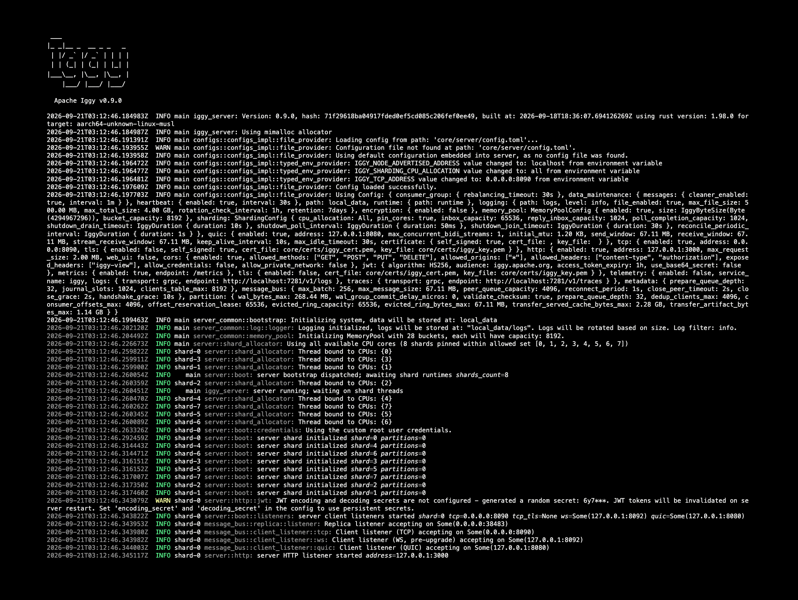
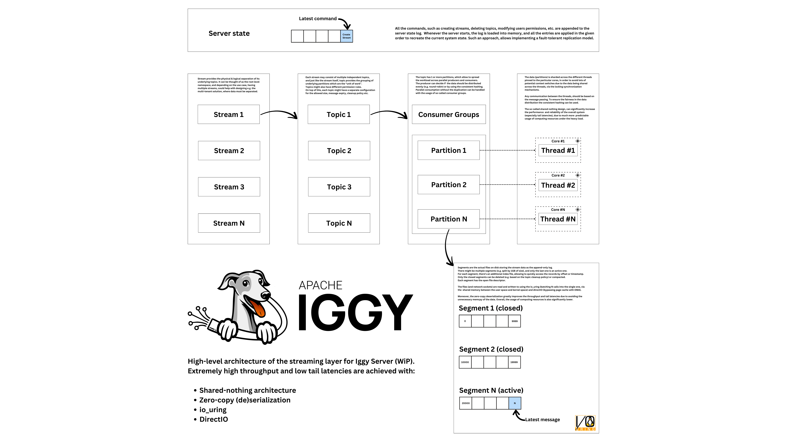

# Apache Iggy Server

The core server component of Apache Iggy: a persistent, append-only log for message streaming. It runs thread-per-core and shared-nothing on `io_uring` (through `compio`), and commits every write through Viewstamped Replication (VSR), so the same binary serves a standalone node and a multi-node cluster.

Clients connect over TCP (custom binary protocol), QUIC, WebSocket, or the HTTP REST API.

## Running

```sh
IGGY_ROOT_USERNAME=iggy IGGY_ROOT_PASSWORD=... cargo run --bin iggy-server --release
```

The leader needs `IGGY_ROOT_USERNAME` and `IGGY_ROOT_PASSWORD` to create root. For local development, `--with-default-root-credentials` sets both to `iggy`. The leader records root in the metadata journal and replicates the same username and password hash to followers. Restarts recover root without these inputs. The server never generates a root password or writes either credential value to its output or log files.

Missing or empty storage is initialized automatically. Existing incompatible
storage is refused without modification. `--fresh` deletes existing data in
the configured system path and must be an explicit reset, never a restart
default. A new cluster starts automatically when its metadata WAL and
superblock are absent. A node with retained metadata rejoins through recovery.
Loss of a replica's entire metadata directory is outside the automatic recovery
guarantee, including loss on every replica. Empty metadata cannot distinguish a
new cluster from a previously used one. Restore a verified consistent backup
through a validated recovery procedure before restarting erased metadata disks.

The Docker image `apache/iggy:latest` ships the server together with the CLI; the `edge` tag tracks the latest development build.

The image binds every listener to `0.0.0.0` so the container is reachable from outside it. A wildcard bind says which interfaces accept connections, not where a client reaches the server, so the address to publish in cluster metadata has to be supplied and the server refuses to start without it. On a single host with published ports that address is `localhost`:

```sh
docker run -p 3000:3000 -p 8090:8090 \
  -e IGGY_NODE_ADVERTISED_ADDRESS=localhost \
  -e IGGY_ROOT_USERNAME=iggy -e IGGY_ROOT_PASSWORD=... apache/iggy:latest
```

Use the hostname or load balancer address clients actually dial when they are not on the same host. The Helm chart derives it from the Service DNS name.

To run one node of a cluster, pass its replica ID from the `cluster.nodes` roster:

```sh
cargo run --bin iggy-server --release -- --replica-id 0
```

Command-line arguments include `--replica-id`, `--fresh` (`-f`), `--with-default-root-credentials`, and `--list-config-env-vars`. Other settings come from configuration.

`scripts/pgo.sh` builds an iggy-server with profile-guided optimization (PGO), and with `--bolt` also with LLVM BOLT. It trains an instrumented 3-node cluster on the build host with `iggy-bench` over TCP, with replicated and persisted durability. By default it compiles for the CPU of the build host. Run `scripts/pgo.sh --help` for the steps and the prerequisites.

## Upgrading

Deploy matching server and SDK releases together. Rolling upgrades and mixed
server versions are unsupported. Partition control frames from older servers
carry incarnation zero and are rejected, so a mixed-version cluster cannot
complete partition view changes. The `IGGY-TIERED-SEGMENT-CHAIN-2` storage gate
requires fresh storage and rejects older data directories without modifying them.
A partition of a tiered topic keeps a chain file, and its older segments live
only in the object store. A build from before tiered storage would read such a
partition as one that lost data, so `IGGY-METADATA-CHANGE-LOG-2` data directories
must be wiped before the upgrade.
Metadata snapshots now carry the metadata change log and topic creation ops, so
`IGGY-RESOURCE-OPTIONS-1` data directories must be wiped before the upgrade.
Cached replies now preserve a committed-result marker, which older receipts lack.
Partition creation records carry an initial view in each 16-byte assignment,
replacing the 12-byte assignments and single request-wide view in older metadata
WAL entries. This boundary also rejects `IGGY-BOUND-GRANTS-4` and
`IGGY-BOUND-GRANTS-5` directories from upstream and earlier development builds,
unchanged before replay.
Replication factors change what replicas send each other: partition member
lists, partition status on metadata probes and replies, retirement debt on session
finalization and the paid-through mark on session retirement. Peers compare a
replica wire revision at the handshake, so a build from before that change and a
build after it refuse each other even when both report the same version, for
example two consecutive `:edge` images. Stop every node and start them all on the
new build.
Topics created without `replication_factor` still go on every node, so clients
that never send the key, which includes every SDK, connector, benchmark and MCP
release before the option, keep the old layout. Set `[cluster]
default_replication_factor` to a number to give those topics fewer copies.
Topic responses carry each partition's member list and in-sync members, a client
wire change that SDKs from before this release cannot decode.

The preceding storage format, `IGGY-METADATA-CHANGE-LOG-2`, used replica wire revision 3. It introduced batched session finalization (op 70) and refused directories marked `IGGY-METADATA-CHANGE-LOG-1` before writing to them.

Server 0.10.1-edge.2 records the account revision and source personal access token used to establish a session. Its replicated registration and password-change requests use replica wire revision 4. State transfer uses client table format `ICT6` and metadata snapshot format 21.

Every replica needs fresh storage with marker `IGGY-TIERED-SEGMENT-CHAIN-2`. Boot refuses a directory marked `IGGY-METADATA-CHANGE-LOG-2`, `IGGY-METADATA-CHANGE-LOG-3` or `IGGY-TIERED-SEGMENT-CHAIN-1` before changing it. Sign in again over HTTP or in the web UI to obtain an access token carrying the account revision.

No in-place upgrade, storage conversion tool or retained-data migration is
provided. Use an offline cutover with logical re-ingestion:

1. Stop application writes, consumers that advance offsets, and administrative
   changes. While the old cluster is still readable, export the required messages
   with an application-specific reader using its compatible SDK. Record payloads,
   headers and per-partition order, topic policies, permissions, and the intended
   consumer restart positions. Check the export against the source before stopping it.
2. Stop every old replica. Preserve a consistent backup of all metadata, partition
   superblocks, WALs, segments and initialization records, with the old binary and
   configuration. Keep these originals unchanged for rollback.
3. Deploy matching new servers and SDKs with separate, empty storage paths on every
   replica. Recreate the required accounts, permissions, streams, topics and groups,
   then re-ingest through the new SDK. New sessions, receipts, partition incarnations
   and offsets do not continue the old ones. Map consumer progress to the re-ingested
   data or choose an explicit new starting position.
4. Verify the restored configuration, permissions, message counts and contents
   before resuming applications. Rollback uses the old binary and its consistent
   backup; it excludes writes accepted by the new cluster unless reconciled separately.

This procedure copies logical application data. It does not convert old storage
files or recover data that is absent from both the source and its backups.

The server no longer generates a root password when `IGGY_ROOT_USERNAME` and `IGGY_ROOT_PASSWORD` are unset. Supply both variables on every replica before the first cluster start so any promoted node can initialize root. Use `--with-default-root-credentials` only in development. A cluster node without credentials waits for root to be replicated. Once root is persisted, restarts need neither.

Releases up to 0.9 printed a generated password to stdout, and 0.9 also wrote it to the log file. Change any root password that was generated, and delete log files and container logs that still hold it. Snapshots redact that legacy log line.

All data directories from earlier storage formats must be wiped before upgrading. The storage-format check rejects them before metadata replay. There is no in-place upgrade or automatic migration.

After storage-format admission, a checkpoint above op 0 preserves initialized metadata. An empty checkpoint at op 0 does not prove that root exists. Without an initialized checkpoint, startup searches the current-format journal for root creation at op 1 because repair can write operations out of order. A journal with complete entries but no validated root creation is rejected before replay.

The error identifies the journal path and any unexpected op 1 fields. Restore a compatible data directory from this storage format, or use `--fresh` to delete local data. In multi-node clusters, use `--fresh` on at most one replica at a time while the others hold quorum.

The diagnostic snapshot (`POST /snapshot`, the binary `GET_SNAPSHOT_FILE` command, `iggy snapshot`) now requires the `manage_servers` permission. `read_servers` alone is rejected, because the archive carries raw server logs and host diagnostics.

All existing self-issued JWT access and refresh tokens are rejected after this
upgrade. HTTP clients and the web UI must log in again. In
`[[http.jwt.trusted_issuers]]`, replace `user_id` with `username`, naming the
account the issuer may act as. The corresponding environment variable changes
from `IGGY_HTTP_JWT_TRUSTED_ISSUERS_<n>_USER_ID` to
`IGGY_HTTP_JWT_TRUSTED_ISSUERS_<n>_USERNAME`.

Builds from #4506 (partition requests routed to their primaries) up to the
release that adds the untrusted-log flag to `DoViewChange` must not run beside
newer servers. A replica in that range reads a newer replica's empty view-change
vote as a log without the latest writes and can drop acknowledged writes. Stop
the cluster and upgrade every replica together. Older builds are not affected,
because their frames carry incarnation zero and are rejected.

Replica links now open with an 8-byte placement preamble, and the replica hello
carries the link count. Nodes from earlier builds and newer nodes refuse each
other's links, so stop the cluster and upgrade every replica together. Every
node must run the same `cluster.coordinator.replica_connections_per_peer`. A
node refuses a peer that runs another value. Shard counts may differ.

Cluster metadata includes `replica_id`. Java's `ClusterNode` record adds a leading
`replicaId` component, changing constructor calls and record patterns. C# callers
must initialize the required `ReplicaId` property. The CLI's cluster metadata list
appends a replica ID column. Swift's `ClusterNode` initializer now requires
`replicaID`. C++'s FFI `ClusterNode`, Rust's `iggy_common::ClusterNode` and
`iggy_binary_protocol::responses::system::ClusterNodeResponse` add the public
`replica_id` field; update aggregate and struct initializers.
Go, Java, Node.js and C# clients use command 105's new
partition routes and refresh on `NotPrimary` (89); use their matching releases.

## Configuration

Settings are read from [config.toml](config.toml), resolved relative to the working directory. Set `IGGY_CONFIG_PATH` to load a different file.

Any single value can be overridden with an `IGGY_`-prefixed environment variable that mirrors the TOML path:

```sh
IGGY_TCP_ADDRESS=127.0.0.1:8090 IGGY_HTTP_ENABLED=false cargo run --bin iggy-server
```

Cluster membership, quorum and replica addressing live under `[cluster]`.

New partition primaries are spread across the configured replicas using each
partition's last observed primary, or its committed initial view before an
observation arrives. Concurrent creates count pending assignments too. Once
readiness probes identify responsive replicas, new primaries are assigned only
to those replicas. Before readiness is known, all configured replicas remain
eligible. After the responsive replica set
has been stable for five seconds, the metadata primary balances existing primary
counts, with up to 512 moves in flight. For each move it confirms the source's
committed frontier and the target's applied history, then grants the move to
the source primary. The
source finishes its accepted writes before it requests a persisted consensus
view change.
Recovering partitions are skipped without delaying transfers of other partitions.
Every replica still stores every partition.
Balancing primary counts does not balance bytes, throughput or CPU load. A hot
partition still has one ordering primary.

On the first stop signal, a node of a cluster hands off the partitions it leads
before it shuts down. Without the handoff, each of them waits for a heartbeat
timeout before it elects a new primary. Each shard spreads them over the members
that are in sync and reachable, and the node takes no primaries while it leaves.
The shutdown waits for every shard to finish, at most
`sharding.shutdown_primary_handoff_timeout` (15 s by default). `"0 s"` skips
the handoff, and so do `"disabled"`, `"none"` and `"unlimited"`, which also read
as zero. A second stop signal ends the handoff. The metadata group has no
handoff and still waits for the timeout.

When a node fails, each partition it led elects a new primary after a heartbeat
timeout. Each shard starts at most 4 of these elections per 10 ms tick, and none
while 128 of its partitions are in a view change. A view change stops counting
once `cluster.view_change_status_timeout` (5 s by default) passes after its
replica wrote the new view to disk. Each view change in a row doubles that
time, up to 16x. Thus partitions that lost their quorum do not stop the
elections of other partitions.
`/metrics` reports `partitions_in_view_change`, every partition of a shard in a
view change, and `partition_view_change_votes_held`, the elections it holds
back.

The 10 ms tick of a shard visits only the partitions with work. A partition
with nothing to commit, replicate, persist or repair sleeps until its next
timeout, and a frame for it or a finished I/O step makes it due on the next
tick. `/metrics` reports `partition_tick_visits`, the visits of a shard, and
`partition_missed_wakeups`, the sleeping partitions that a check found with
work and woke. That check tests a few sleeping partitions per tick. Its
counter stays at 0 on a correct server, so report a value above 0 as a bug.

A create whose namespace is invalid can receive 58 (`TransientNotAccepted`) while
any metadata write is pending, even an unrelated one. Under steady unrelated
traffic its retries can reach the deadline with 58 instead of the namespace
error. A valid create that exceeds its configured capacity with the committed
partitions alone still gets the capacity error. If only the creates in flight
leave no room, it gets 58, and under steady create traffic its retries can reach
the deadline with 58. A personal access token create follows the same rule for
the user's tokens and `max_tokens_per_user`.

### HTTP routing and backpressure

An HTTP client therefore often calls a node that is not the partition primary.
If every node accepts the caller's bearer, that node relays message sends, polls
and consumer offset calls to the primary. This needs identical `http.jwt`
secrets on every node, or `cluster.auth`. Without that key material, these calls
answer a transient 503 with code 58 (`TransientNotAccepted`).

A partition relay carries an HMAC-SHA256 proof over its method, path and query,
route, and expiry. The target still authenticates and authorizes the caller.
The relay key derives from the first configured `http.jwt.encoding_secret` or
`http.jwt.decoding_secret`, otherwise from `cluster.auth.shared_secret`.
Keep that material identical on every node. Rotating the material used for
bearers also changes the relay key, so nodes with different keys refuse each
other's relays. Keep node wall clocks synchronized within a few seconds: a proof
has a 10-second lifetime. Relay numeric fields use unsigned decimal with no
leading zeros, and proof tags use lowercase hexadecimal; noncanonical fields
are refused. Proxies must preserve these internal headers unchanged.

A target refuses a missing, invalid or expired proof with 403. When a node's own
relay proof is refused, that node logs a warning and answers the application with
503, code `relay_refused`, and `Retry-After: 1`. Nothing was admitted by that
attempt. Check shared keys and clocks; this response is not a denial of the
application's permission. SDKs with HTTP transports use their ordinary 503 retry
policy. Rust and Python use their configured retry schedule rather than
`Retry-After`; C# honors its delta value; Java uses Apache HttpClient's ordinary
429/503 retry strategy.

A 503 answer to a write means that nothing was admitted, so the write can be sent
again. A 502 or 504 answer to a write means that its outcome is unknown, and the
write can still commit. The body `id` 57 (`TransientNotCommitted`) or the body
`code`, such as `produce_timeout`, names the cause. Read the state before writing
again, because a resend is a new request that can apply twice. The Rust, C# and
Java SDKs never resend such a write, and the Rust SDK reports it as 57.

Metadata forwards and partition relays share a limit of
128 concurrent forwards per node. New forwards at capacity return 503 `forward_busy` with
`Retry-After: 1`. Metadata forwarding has one 30-second retry budget beginning
before the request body is buffered, so a slow upload leaves less time for
forwarding. Partition requests share a 10-second deadline across their metadata
wait, local attempts, relays and reply waits.

A node sends one metadata-floor read at a time and holds no forward slot for it. The read serves every linearizable read that arrived before it was sent, and the reads that arrive while it is in flight share the next one.

Socket replies use `message_bus.client_queue_capacity` per connection. A reply that cannot enter the non-waiting queue closes that connection, leaving the caller to recover any uncertain operation. Paths that wait for reply space hold their bounded permit until delivery or connection teardown.

A reply that waits longer than `message_bus.client_write_stall_timeout` (30 seconds by default) closes the connection, so a client that stops reading its socket, an administrative one included, holds its queue and request tasks for at most that long.

Requests queued behind the ones a connection runs are capped at 1024 frames and at `message_bus.client_request_queue_bytes_max` (256 MiB by default). A request past either cap gets 58 (`TransientNotAccepted`), unless the queue is empty.

### Metadata freshness and counters

On a multi-replica node, client partition requests require recent metadata quorum
evidence before namespace lookup and authorization. The evidence lasts
`K = cluster.commit_busy_heartbeat_timeout + 3 seconds` (8 seconds by default); expired or
absent evidence yields 58. A primary credits answered probes while ready. A
backup credits only a probe from its current metadata primary whose advertised
commit covers the adopted view's head and is already applied locally. Commit
messages alone do not renew this evidence.

The gate uses elapsed time, so a brief view or role change preserves existing
credit without restarting its lifetime. A restarted node has no credit until
fresh evidence arrives. Single-replica nodes do not require network evidence.
A primary advertises evidence to a backup only after that backup answered its
previous probe. The backup ages the evidence from the arrival of that previous
probe. A delayed probe therefore cannot extend backup credit past K. The one
exception is a primary restart in the same view: a late probe of the old
incarnation can then add its own transit time. The aging costs up to one probe
interval of credit. If the primary stops probing, a backup therefore stops
admitting up to one probe interval before the primary does.
K is a lease, not an instantaneous revocation guarantee.

Message and size counters in stream, topic and system stats (`get_stream`,
`get_topic`, `get_stats` and the list forms) are counted per node. A node that
is not the partition primary learns of a commit from the next prepare or from
the periodic commit broadcast. It counts the message only then. While the
cluster is idle, its counters can lag by up to `cluster.commit_busy_heartbeat_interval`.

`GetStats` and the stream, topic, partition, segment and message gauges of
`/metrics` read node totals. Each metadata change and each partition write
keeps these totals up to date, so these reads walk no stream. The per-topic
series of `/metrics` (`topic_size_bytes`, `topic_messages` and
`topic_max_size_bytes`) still walk every topic on each scrape. On a node with
many topics, set `[http.metrics] topic_gauges = false` to drop them.

### Sessions and retry receipts

Protocol 0.11.1 and later use client-owned registration proofs and `BindSession` (15) to
share a logical session across connections. Commands 14, 103, 104, 123 and 124 are
retired. Partition routing uses 105, polling uses 100 and offset reads use 120. Disconnecting a
connection does not log out its logical session. Server-observed activity renews
the session lease, and expiry or explicit logout retires it before capacity is
reused.

External group offsets belong to groups managed outside Iggy, such as a Kafka
gateway. They require no Iggy group membership and can exceed the partition's
message-offset range.

The bind proof binds a connection to a session the owner opened with a credential. Binding checks that the owner still exists and is active, and that a session opened with a personal access token still has that token, unexpired. Current permissions still govern each request. Explicit logout, lease expiry, user deactivation and user deletion end session access.

A successful password change ends every session of the account except the TCP, QUIC or WebSocket session that made the change. It invalidates all previously issued Iggy access tokens for that account, including tokens exchanged from personal access tokens. An HTTP self-change also closes its submitting session. A caller presenting a self-issued token must sign in again.

Deleting a personal access token ends the sessions opened with it and the access tokens exchanged from it. Its expiry stops them at the expiry time, before the cleaner deletes it, and an access token exchanged from it never outlives it. Personal access tokens survive a password change, so a service that signs in with one opens a new session after the change.

Deactivating an account ends every session and deletes all its personal access tokens. After reactivation, sign in again and issue new personal access tokens.

Each node decides from the metadata it has applied. A node that has not applied a password change or a token delete yet still serves the old credential until it does. Over HTTP it answers an access token issued after a password change it has not applied with a retryable refusal.

A registration proved against a superseded account revision or a deleted token is refused. The client can sign in again with a current credential. A session that ends during a send leaves that send uncertain, as described below.

If a committed reply is lost and that session ends before the caller proves the
outcome, the operation remains uncertain. Signing in again, including after
reactivation, cannot recover the old session's receipt. Reconcile application
state before submitting a new operation; a fresh send can duplicate the old one.
A result already proved and cached by an SDK remains subject to that SDK's local
outcome-cache lifetime.

Permission revocation alone keeps the session alive. Partition retries check
current permissions before receipt lookup and return 41 (`Unauthorized`) until
a re-grant. A retained operation can then resolve its original receipt under the
same session. Metadata retries may replay that user's own committed cached reply
without checking the revoked permission again; a new metadata mutation still
requires authorization. An uncommitted refusal does not settle an earlier
uncertain attempt.

An explicit SDK sign-in or logout ends earlier calls: an unsent call fails with
40 (`Unauthenticated`), while a possibly applied mutation remains uncertain.
Only SDK-managed recovery can continue an unsent waiting call under a replacement
session. It never replays an uncertain mutation under a new identity. A session
wait reaching its deadline fails with 58, and a refused automatic sign-in fails
with 40. The Rust SDK, and the C++, PHP and Python bindings built on it, log the
refusal as a warning. The other SDKs attach it as the cause of that 40. Recovery
uses the caller's last explicit sign-in, falling back to configured automatic
credentials only before
any explicit sign-in. Logout disables automatic sign-in; consult the SDK's
connect/disconnect contract before opening a new session. Swift reports an
unknown mutation as 57 and has no retained-operation resolver.

Error 5009 (`ConsumerGroupPartitionNotOwned`) names the full 128-bit VSR client
ID. `GetClient` and `GetClients` expose the low 32 bits of a transport connection
ID, which is a different identity. Their client IDs cannot be used to look up the
VSR identity in a 5009 diagnostic.

`clients_table_max` and `dedup_clients_max` nominate immutable limits when the
first operation commits in each metadata or partition group. Recovery and state
transfer preserve those committed limits. Configuration changes affect groups
that have not committed a limit yet; existing groups log a mismatch and retain
their committed capacity. At capacity, new sessions or writers are refused until
ordered retirement releases slots. Live retry protection is never evicted.

HTTP writes using one session and partition serialize through the previous
write's reply or bounded deadline. With `ack=none`, a request returns 202 after
its dispatch, while the next request to that partition waits for the previous
write to settle. Waiters acquire the in-flight permit after the partition gate,
so they do not consume the session's budget for other partitions.

Durability defaults remain `Replicated`. A geo topic in the `geo` mode has no
choice: it is always `Persisted`, and the option is ignored on create. See
[geo topics](docs/GEO_TOPICS.md#create-a-geo-topic).
Ordinary SDK sends and explicit offset writes support the configured policy.
Crash-safe send retries require `Persisted`; crash-safe explicit offset retries
require `Persisted` and `Quorum`. Weaker policies can lose data and receipts on a crash. A retained
receipt still replays its original result, but a lost receipt cannot prevent
another execution. NoAck and internal auto-commit polls retain their weaker
completion contracts.

Auto-commit polls are at-most-once: the owner can advance an offset before the
gateway's final authorization check. If the session ends or permissions are
revoked during that return hop, the response is denied and the batch can be lost.

Topics have an immutable `partition_resize_policy` creation option. The default,
`mutable`, permits partition addition and deletion without a bounded cutover or
per-key ordering across partition layouts. `fixed` rejects both operations with
`PartitionResizeDisabled` (2023). Existing messages stay in their original
partitions. Neither policy prevents retention or deletion of the topic.
Set the option through `TopicCreateOptions::partition_resize_policy`, HTTP's
`options` map, or the CLI's `--set partition_resize_policy=fixed`.

### Replication factor

A topic's create-only `replication_factor` is the number of nodes that store
each of its partitions. It applies to every partition of the topic, including
ones added later, and takes 1 to 32 but no more than the cluster's node count.
Any other number is refused with `InvalidReplicationFactor` (2018), and a value
that is not a number with `InvalidOptionValue` (4042). Omitted, it is the
server's `[cluster] default_replication_factor`: `"all"` by default, which stores
each partition on every node, or a number from 1 to 32, lowered to the node count
when larger, so `"3"` keeps three copies on clusters of any size, like Kafka's
`default.replication.factor`. The metadata primary resolves it when it admits the
create, so set the same value on every node. `DescribeOptions` reports the value
that node resolves to, and a topic created without the key stores it as derived.
Metadata is always on every node.

`GetTopic` lists, for each partition, its `members`, the node ids that store it,
and its `in_sync_members`, the members its primary last reported in sync, which
the metadata primary narrows to the nodes answering its probes. A member missing
from the second list is down or behind. Before restarting a node, check that
every partition it is a member of keeps, without it, enough in-sync members to
elect a primary: 2 of 2 or 3, 3 of 4 or 5, 4 of 6, and 5 of 7. A restart of a
node that leads a partition needs that many, not just a write quorum.
The in-sync list is empty until a partition's primary first reports, about a
second after it is created, and from shortly after its primary stops leading it
until a member leads it again. A primary reports only while it leads, and the
metadata primary drops a report it has not heard again for 6 seconds, 2 more for
every 512 partitions past the first 512 in the cluster.

At create the metadata primary picks each partition's nodes: the primary is the
ready node leading the fewest partitions, and the other members are the nodes
storing the fewest, each in a rack the partition does not use yet while one has
a ready node, like Kafka's `broker.rack`. A node names its rack, or availability
zone, with `rack` in its `[[cluster.nodes]]` entry. Set it on every node or on
none: a node starts with a configuration that sets it on only some. Each rack
then holds about an equal share of the copies, so a rack with fewer nodes puts
more on each of them, and with a factor equal to the number of racks a rack of
one node stores every partition. A node that is down is picked only when too few
are up. The assignment never moves. While a member is down its partitions run
with fewer copies, and the member catches up from the others when it comes back.
A new metadata primary refuses creates with `TransientNotAccepted` (58) until
every node has answered its probe or missed it, so the node whose failure
started the view is not picked.

The metadata primary reports in `/metrics`, on its first shard, the cluster's
`partitions_under_replicated`, partitions with a member out of sync, and
`partitions_below_write_quorum`, partitions that cannot commit. For a partition
whose primary answers its probes, it counts the members of the primary's last
report that answer too: a member is out of the report while the primary cannot
reach it or while it has trailed the commit point for 30 seconds, Kafka's
`replica.lag.time.max.ms` default. A dropped report, or none that long after the
partition is created, counts no member, as when every member is up but none can
lead, such as both members of a factor-2 partition back on empty storage. For a
partition whose primary does not answer, it counts the members that answer,
which must be enough to elect a primary before anything commits. Every other
node reports 0, so, like Kafka's `UnderReplicatedPartitions`, summing the series
over every node gives the cluster's total.

A write commits on a quorum of a partition's members: 2 of 3, 3 of 5, and at
most 3 for wider groups. A factor of 2 keeps two copies but stops accepting
writes while either member is down, like Kafka with `min.insync.replicas=2`,
because the two members have no third party to decide between them. A factor
of 1 keeps one copy, and the default `replicated` durability acknowledges a
write before that copy reaches disk; set `durability=persisted` on such a topic
to acknowledge only written data.

Deleting a topic or stream waits while one of its partitions lacks a quorum of
its members, and completes once they return, like Kafka's pending deletes, or
once enough of them came back without their copy that the rest cannot elect a
primary: 1 of 2, 2 of 3 or 4, and 3 of 5. A pending consumer group deletion on
the topic does not hold the delete back: the delete takes it over and removes
the group with the topic.

Logins keep working while a partition lacks a quorum of its members. A session
that ends then cannot be retired on that partition, so the partition owes the
retirement instead of holding the session's slot in the client table. The
partition's next primary pays it before serving sessions again, and refuses
their requests and polls that commit their offset on read with
`TransientNotAccepted` (58) until it has. `/metrics`
reports `partitions_owing_retirement`, the partitions still refusing sessions
for that reason, and `retirement_debts_paid`, the payments a node made.

A node that comes back with empty storage refuses to serve a factor-1
partition created before it, because that data was only on this node and
serving it again would reuse its offsets. A member of a wider partition copies
the data from a member that kept it instead. Until then it never leads, and it
votes in an election only to let every member report, which elects a member that
kept the data once fewer than a write quorum of members lost theirs. So a
2-member partition elects its other member when one member comes back empty, as
replacing one disk at a time with `--fresh` does, and a 3-member partition with
one member down and another back on empty storage waits for the one that is
down. With `durability` and `consumer_offset_durability` both `persisted`, if a
write quorum of members lost their storage, none of them serves the partition
rather than restart it at offset 0 or without ops that only they held, like Kafka
with `unclean.leader.election.enable` off. Delete and recreate the topic to
accept the loss: the delete completes once the members that lost their copy
leave too few to elect a primary, and frees the name. The default `replicated`
durability acknowledges a write before it reaches the disk, so a restart of
every member can lose acknowledged writes, and members that lost their storage
are counted the same way: once every member reports, the partition elects on the
logs that are left, like Kafka with `unclean.leader.election.enable` on.

A node that does not store a partition answers its route lookups from what the
partition's primary last reported, or from the partition's initial primary
before any report, and it refuses sends and polls for it with `NotPrimary`, so
clients go to the primary. The metadata primary relays a report that names a
new primary or changes the in-sync members in its next probe, about a second
after it hears it, and cycles through the others 512 per probe. Its topic and
stream counters follow those reports too, so they trail the members.

Topics created before replication factors keep every partition on every node.

### Tiered storage

The `[tiered_storage]` section of [config.toml](config.toml) names an object
store for the sealed segments of tiered topics. A topic with `tiered_storage`
on uploads each sealed segment there, removes the local copy once local
retention allows it, and reads the segment back from the store when a poll
asks for it. Geo topics keep their messages in the same store: see
[geo topics](docs/GEO_TOPICS.md).

The cluster accepts `tiered_storage` on a topic only while every node has a
backend and passes the store identity check described below. Until then the
request fails with `FeatureUnavailable`.

A poll reads an object in the store in blocks of `read_cache_block_size`,
256 KiB by default, and each shard keeps up to `read_cache_size` of them in
memory: tiered and long-term segments, the indexes of long-term segments, fresh
objects, and the segments of geo peers. The index of a tiered segment is not
kept there: a poll fetches it once into a local index file on disk. A smaller
block wastes less on small or random reads, and a larger one suits consumers
that read forward. A poll of bytes that
another poll read a moment ago takes them from there, and polls that miss the
same block at once share one read. When polls read a segment in order, the
shard also fetches up to `read_ahead` bytes past the last poll before any poll
asks for them, on into the next segment. These fetches take the speculative
fetch caps of `[tiered_storage.jobs]`. One starts only while no fetch that a
poll waits for is queued, and it can run beside the ones that already run. The
same budget holds the fresh objects a shard uploads for geo topics, in up to
seven eighths of it, until the long-term rewrite takes their messages, so a
consumer at the tail reads them from memory, and a rewrite hands the end of
each long-term segment it stores to the cache. A shard with a high upload rate
wants 64 MiB or more. With `read_cache_size` at 0, each poll reads exactly its
bytes from the store and nothing it fetches is kept, but the shard still holds
what it uploads, in a fixed 64 MiB of its own. A geo peer's bytes are served
only while the node reads that peer, and never across a change of the cluster
that owns its root. The budget is shared by every partition of the shard.

A topic can set `read_cache_size` and `read_ahead` for itself, on a normal and
on a geo topic, and an update can change them without a restart. The topic's
`read_cache_size` is shared evenly between its partitions, and each share is a
limit on what that partition keeps within the cache of its shard, not a
reservation: a partition over its limit evicts its own blocks, and what a quiet
partition leaves unused is there for the others. A share below 8 blocks of the
node's `read_cache_block_size` keeps nothing. The topic's `read_ahead` replaces
the node's for its readers, and a partition reads ahead at most an eighth of
its share and an eighth of the cache of its shard. `0` turns either off for the
topic. Unset, each node applies its own
setting: only the cache of the shard bounds the topic's partitions, and they
read ahead the node's `read_ahead`. Neither can be reset. The fresh objects a
shard uploads are held for the polls at the tail whatever a topic sets. A
topic without `tiered_storage` accepts both, and they apply once its reads go
to the store. A shadow topic reads with the values that the geo topic it
shadows sets, see [Shadow streams](#shadow-streams), and no client can set
them on it. The
counters `remote_read_block_hits_total`, `remote_read_block_misses_total`,
`remote_read_ahead_hits_total`, `remote_read_blocks_fetched_ahead_total`,
`remote_read_demand_bytes_total`, `remote_read_ahead_bytes_total`,
`remote_read_fresh_releases_total`, `remote_read_carried_bytes_total` and
`remote_read_limit_evictions_total`, the blocks and whole objects, such as a
segment's `.index`, that left because their partition was over its limit, and the gauges `remote_read_cache_bytes` and
`remote_read_held_bytes`, show what the cache of each shard does.

A replica rebuilt by state transfer gets only the records of the segments
that the store holds, and reads those segments from the store. A replica that
cannot read its store waits for it before it rebuilds a tiered partition, and
stays behind its group until then.

Each partition of a tiered topic also has a manifest object,
`<prefix>/meta/<stream>/<topic>/<partition>/<created_revision>/manifest.bin`.
It lists the segments that the store holds, with their offsets, timestamps,
sizes and checksums, so a reader that has only the bucket can read the
partition. Such a reader takes only the segments that the manifest lists. Any
other object under the partition's prefix can belong to an upload that never
committed, or to a segment that retention removed. The partition's primary
writes it on each run of the message cleaner, when a segment was uploaded or
removed since the last one. The cluster never reads its own manifests back.
The objects of a removed segment are deleted only once the manifest no longer
lists it.

The `fs` backend keeps the objects in a directory. The `s3` backend keeps them
in a bucket on AWS S3 or on a store with its API, such as Ceph RGW or R2. With
an empty `endpoint`, it uses AWS in `region`. `url_style` picks whether the
bucket goes in the URL path or in the host name.

The `gcs` backend keeps the objects in a Google Cloud Storage bucket, which
`[tiered_storage.gcs]` names. It talks to the JSON API of GCS, never to its
S3 interoperability endpoint: GCS takes a create-only put as its own
`ifGenerationMatch=0` precondition, and the server relies on create-only puts.
An empty `endpoint` is Google Cloud Storage. An emulator, such as
fake-gcs-server, takes its own URL and `auth = "none"`. GCS takes one write
per second to one object name, so on `gcs` set `[geo]
consumer_offset_upload_interval` to `1 s` or more, or to `disabled`.

The `mock_s3` backend keeps the objects in the memory of the server, where
every shard reads them, and answers each call after the latencies of
`[tiered_storage.mock_s3]`. The server loses them all when it stops, so it is
for benchmarks and tests only.

The `s3` backend signs each request with the first credentials that the node
has, in the order of the AWS SDKs:

1. The static keys `access_key_id` and `secret_access_key`.
2. Web identity: the token in `AWS_WEB_IDENTITY_TOKEN_FILE`, which STS
   exchanges for credentials of `AWS_ROLE_ARN`. EKS sets both variables for a
   pod with a service account role. `AWS_ROLE_SESSION_NAME` and
   `AWS_ENDPOINT_URL_STS` change the session name and the STS URL.
3. The role of the EC2 instance, from its instance metadata service.
   `AWS_EC2_METADATA_DISABLED=true` turns this source off, and
   `AWS_EC2_METADATA_SERVICE_ENDPOINT` moves the service.

The node fetches temporary credentials once and shares them with every shard.
It fetches new ones 5 minutes before the old ones expire. If a fetch fails,
the node keeps the credentials that it has and tries again. The first retry
comes after 1 second, and the wait doubles up to 1 minute. If the source
refuses the first fetch,
for example because the role does not trust the token, the server does not
start. If the source does not answer at boot, the server starts without
credentials and keeps trying. No log line shows a key or a token.

With `auth = "auto"`, the `gcs` backend sends an access token from the first
source that the node has, in the order of Google's application default
credentials:

1. The service account JSON key file that `service_account_key` names. The
   node signs a JWT with its key and exchanges it at the key's `token_uri`.
2. The key file that `GOOGLE_APPLICATION_CREDENTIALS` names.
3. The metadata server of the Compute Engine instance or the GKE node, which
   on GKE with Workload Identity hands out the token of the pod's service
   account. `GCE_METADATA_HOST` moves it.

Only `service_account` key files work. A file that cannot be read or holds no
RSA key stops the boot. The token reaches every shard and is refreshed as the
`s3` credentials are. The service account needs the Storage Object User role
on the bucket.

At boot the server reads the store identity object `<prefix>/meta/identity`
once. Only a missing bucket, rejected credentials or a store that ignores
create-only puts stop the boot. If the store does not answer within
`request_timeout`, or 5 seconds at most, the server starts with the
`object_store_unreachable` gauge at 1. The store identity check judges any
other answer.

Fresh objects, segment uploads, the store identity object and recovery records
are all written create-only, so of two writers that race on one key only one
wins. A store that takes `If-None-Match` and overwrites anyway breaks that for
all of them. So once the identity object holds this cluster's id, each node
puts the same bytes once more, create-only, before its first upload, and the
store must refuse that put. A store that takes it fails the check: the node
runs no uploads or object deletes, and logs the settings to fix. At boot the
probe sends the same put when the object is already there, and a store that
takes it stops the boot. Either way the put writes the bytes that the object
already holds.

The store identity object claims the prefix for one cluster. While replica 0 is
the caught-up metadata primary and no topic keeps data in the store, it writes
the object. A tiered topic keeps data in the store, and so does a topic whose
partitions place their batches. If the key already holds an object, the write
fails. Each node reads the object
back through its own store every minute, or every 5 seconds while the object is
missing or the store does not answer. While the object names the node's own
cluster, the node runs uploads and object deletes.

While another replica leads metadata, no node claims the prefix, and each node
logs that no cluster claimed it yet. `iggy cluster metadata` shows the leader.
Restart the leader, and the next replica takes over. Repeat until replica 0
leads.

Each shard exports two gauges for its node:

- `object_store_identity_verified` is 1 while the node passes its check. It is
  0 until replica 0 claims the prefix, and while the object is missing or names
  another cluster.
- `object_store_unreachable` is 1 while the store does not answer the check. A
  node that passed keeps passing through an outage.

Uploads that fail on a store that answers the check show in
`partition_segment_upload_lag_seconds`, not in these gauges.

The object holds two lines of text, and each line ends with a newline:

```text
iggy-store-identity 1
cluster_uid 0123456789abcdef0011223344556677
```

`cluster_uid` is 32 lowercase hexadecimal digits. When the result of its check
changes, each node logs its own `cluster_uid`. No node writes the object again
once a topic keeps data in the store.

With the `fs` backend, the object is the file `<path>/<prefix>/meta/identity`.
Copy it once a node logs that the object store root belongs to this cluster. If
the file is lost or damaged later, put the copy back. A hand-written file does
not work, because `fs` keeps a header before the body of each object file. A
node that finds a wrong file still boots, but it runs no uploads or object
deletes until the right file is back.

With the `s3` and `gcs` backends, the object is the key `<prefix>/meta/identity`
in the bucket. If it is lost or damaged, write the two lines back under that
key with any client of the store, such as `gcloud storage cp`. Each node logs
the `cluster_uid` to write.

A node logs that the object names another cluster when:

- Another cluster uses the same prefix. Give this cluster another `prefix`.
- This cluster's metadata was rebuilt, which gives it a new `cluster_uid`. The
  objects under the prefix belong to its earlier lifetime. Give the cluster
  another `prefix`, or delete every object under the prefix, and replica 0
  claims it again. A cluster rebuilt after every node lost its disk can
  instead take back the geo topics of its earlier lifetime with
  `[geo] recover_cluster_uid`, as [Recover an origin that lost its
  disks](docs/GEO_TOPICS.md#recover-an-origin-that-lost-its-disks) describes.
- The object holds bytes that no cluster wrote. Put the `fs` copy back, or
  write the two lines again on `s3` or `gcs`.

Give every node the same store and the same prefix. The check cannot tell every
pair of stores apart. For example, replica 0 reaches an empty store, and the
other nodes reach a store with an earlier claim of the same cluster. Then every
node passes its check. Until a topic keeps data in the store, replica 0 also
claims again after any check that did not pass, so if its `fs` mount drops, it
claims the empty mount point.

### Geo peers

[Geo topics](docs/GEO_TOPICS.md) is the operator guide: what a geo topic
guarantees, how to set up two clusters, how clients use them, the delays, what
is lost when a datacenter fails, and the limits of this version. This section
and the two after it are the reference for the parts it builds on.

The `[geo]` section of `config.toml` names this cluster among the datacenters
and lists its peers: the other clusters whose stores it reads.
`origin` is the name of this cluster. Shadow stream names and the objects that
this cluster publishes for its peers carry it. An origin name holds 1 to 32
lowercase letters, digits and `-`. It starts with a letter and does not end
with `-`. A cluster with peers needs an origin.

Each `[[geo.peers]]` table gives the peer's `origin` and the keys of the peer's
`[tiered_storage]` store: `backend`, `prefix`, `path` for `fs`, `bucket`,
`region`, `endpoint` and `url_style` for `s3`, and a `[geo.peers.gcs]` table
for `gcs`, with the keys of `[tiered_storage.gcs]`. An `s3` peer needs the
static keys `access_key_id` and `secret_access_key`. The printed configuration
never shows them. A `gcs` peer takes its token as the `gcs` backend does, from
a refresher of its own, and the boot never waits for that token. A cluster
reads at most 16 peers.

The server never writes to a peer's store. Each shard reads a peer through a
store that refuses every put, conditional create and delete before the request
leaves the node. Read-only credentials are therefore enough. Each shard runs
one tier service per peer, with the timeouts and job caps of
`[tiered_storage]`. A slow peer takes no job slot of this cluster's store or of
another peer.

When the node starts, shard 0 reads each peer's store identity object,
`<prefix>/meta/identity`. After that it reads the object every minute. While the node
reads nothing from the peer, or the peer's store does not answer, it reads the
object every 5 seconds.

Each check compares the cluster that the object names with the clusters that
committed metadata recorded for the peer: the ones its shadow streams came
from, and for a retired peer the ones its retirement kept. The node reads the
peer when the object names one of them. While metadata holds no shadow stream
of the peer, the node takes the first cluster that the object names. When the
object names another cluster, the node follows the recovery records under the
peer's root, `<prefix>/meta/recovery/<cluster_uid>/record`, from a recorded
cluster. A cluster that a recovery rebuilt from the store of a recorded one
writes such a record, so the node reads the peer as that successor. The node
reads a record only in this case, and once for each cluster that it finds.
A check reads a few records at most, and the next check, 5 seconds later,
goes on where it stopped, until the records end or lead back to a cluster
that it read. Until the records prove the cluster, also while the store does
not answer the read of a record, the node reads nothing from the peer. The
node keeps what it found in memory only, so after a restart it judges the
object again against what metadata recorded.

When metadata changes the clusters that it records for the peer, and the
cluster that the node reads is neither one of them nor a successor that the
records proved, the node stops reading the peer and checks it at once.

A pass that commits what it read of a peer, the manifests of its partitions or
the positions of its groups, reads the identity object before its other reads
and after them. It commits what it read only when both reads name the cluster
that the node reads the peer as. Otherwise it commits nothing, and asks shard
0 to check the peer within a second, so the polls of the peer stop too.

Only a configuration that can never work stops the boot, for example a prefix
that is not a usable key prefix. A peer whose store does not answer never stops
the boot and never delays local traffic.

Each shard exports two gauges for its node per peer, labelled with the peer's
`origin`:

- `geo_peer_identity_verified` is 1 while the node reads the peer. It is 0
  until a check reads the peer's identity object, and while the object is
  missing, refused, changed or names a cluster that metadata did not record.
- `geo_peer_unreachable` is 1 while the peer's store does not answer the check.
  A node that verified the peer keeps reading what the store returns.

A node logs that the identity object of a geo peer no longer names the cluster
that it read first. From then on, the node reads nothing from the peer until it
restarts. This happens when:

- The peer's metadata was rebuilt, which gives the peer a new `cluster_uid`.
  Its stream, topic and partition ids start again, so the objects under its
  prefix belong to another history.
- The peer's entry in this file now points at the store of another cluster.
  Correct the entry.
- The object holds bytes that no cluster wrote. The peer's operator puts the
  object back, as the tiered storage section describes.

Before you restart the node, find out which cluster owns the peer's prefix now.
After the restart, the node reads the peer only if the cluster that it finds
then is one that its shadow streams of the peer came from, or a successor that
recovery records prove.

A node logs that the root of a geo peer is claimed by a cluster that its
shadow streams did not come from when a check finds such a cluster and no
recovery record leads to it. It names the recorded clusters and the one it
found, and reads nothing from the peer. This happens when the peer's entry
points at the store of another cluster, or when the peer's metadata was
rebuilt without a recovery. Correct the entry, or retire the origin when the
cluster that the shadow streams follow is gone. The next check after metadata
changes what it records of the peer judges the object again.

A node also reads nothing from a peer whose identity object names this cluster.
Then the peer's store and prefix are this cluster's own.

### Geo topic objects

The cluster publishes one object for each of its geo topics in its own
`[tiered_storage]` store, under
`<prefix>/meta/topics/<stream_id>/<topic_id>/<created_revision>`. A peer reads
these objects to find the geo topics of this cluster. One listing of
`<prefix>/meta/topics/` finds all of them. An object holds the origin, the
`cluster_uid`, the stream and topic names and ids, and the partition count. It
also holds the compression algorithm, the largest message size, the retention
limits, the geo mode, and the `read_cache_size` and `read_ahead` that the topic
sets.

The caught-up metadata primary stores the object of a new geo topic within
about a second of its creation. When the content of the object changes, for
example after a stream rename or an update of the topic's read cache settings,
it stores the object again. The primary of each
partition of a geo topic reads the object before it takes messages, and again
after each change of primary. Until then, the partition refuses messages with
`TransientNotAccepted`, which the SDKs retry. A store that does not answer
therefore delays the first messages of a new geo topic, but the topic stays.

When a client deletes a geo topic, the metadata primary replaces its object with
a tombstone. A tombstone tells the peers that the topic is gone. The primary
lists the topic objects once a minute. The grace is the topic's own
`tombstone_grace`, which its object records, or else `[geo] tombstone_grace` (24
hours by default). After the grace, the primary deletes the segments and
manifests of the topic, and then the tombstone. The tombstone records the time
of its write. A restart or a new metadata primary therefore does not restart the
grace.

### Shadow streams

A cluster serves the geo topics of each peer that it reads as shadow streams.
A shadow stream is named `__shadow_<origin>_<stream>`, after the peer's origin
and stream name. It holds the geo topics of that peer stream, with the peer's
topic ids and partition ids. The normal topics of the peer stream do not
appear. The partitions of a shadow topic keep none of the peer's messages on
this node's disk. They read the peer's log from the peer's store, as the
manifests that they committed list it: see
[Following peer manifests](#following-peer-manifests).

Every 5 seconds, the caught-up metadata primary lists the topic objects of each
peer. It reads each new object, and it reads a known object again every 30
seconds. Then it proposes each change through the metadata consensus of this
cluster, one operation at a time, so every node holds the same shadow streams:

- A live object of a new peer stream creates its shadow stream.
- A live object adds its topic to the shadow stream.
- A renamed peer stream renames its shadow stream.
- A tombstone detaches the shadow topic. The topic stays readable until
  `tombstone_grace` passed since the peer wrote the tombstone. Then the primary
  removes it.
- An object that the peer's store no longer lists for 2 minutes removes its
  shadow topic.
- A shadow stream without topics and without live objects is removed.
- A shadow topic takes the `read_cache_size` and `read_ahead` that its live
  object sets, at its adoption and after each change, and a key that the
  object does not set is unset on the shadow topic too. The values stay as the
  peer set them: each node bounds them to its own cache as it does for any
  topic. While the peer's store does not answer, and after its origin retired,
  a shadow topic keeps the last values it took.

A read of a shadow stream, alone or in a listing, reports the read-only key
`shadow_origin` with the peer's origin, and no other stream carries it. Every
SDK has a typed getter for it, and `iggy stream list` shows it in the Origin
column. A read of a shadow topic reports `topic_type` as `geo` and the
`geo_mode` of the peer's topic, although the topic is stored as a normal one.
`iggy topic get` shows the type, the mode and, in a shadow stream, the origin
of a topic.

Clients read a shadow stream like any other stream. Consumer groups, consumer
offsets and permissions work on it, and its positions stay in this cluster. A
client cannot write to a shadow stream or change it. The server refuses these
requests with `ShadowStreamReadOnly` (1021): a send, a topic create, update or
delete, a partition add or delete, a segment delete, and a stream update or
delete. A stream create or rename to a name that starts with `__shadow_`
returns `InvalidStreamName` (1013).

If a stream of this cluster already has the name of a shadow stream, the
server logs it and adopts nothing for that peer stream. Rename the stream to
let the peer's topics in. A peer stream whose shadow stream name is longer than
255 bytes is also logged and skipped.

A shadow topic is stale while the peer's store does not answer, or while the
node reads nothing from the peer. A stale topic serves what it holds. The
primary removes no stale topic, except one whose grace ended. The gauge
`geo_shadow_topics_stale`, labelled with the peer's `origin`, counts the stale
shadow topics on the metadata primary.

If the identity object of a peer names another cluster than the one that the
shadow streams came from, the server logs it. It leaves those shadow streams
as they are, unless the node reads the peer as the successor that recovery
records prove of the only cluster that metadata records of the peer. Then the
shadow streams follow the successor's topic objects, and a stream of the
successor without a shadow stream gets none.

An operator retires a peer whose datacenter never returns with
`iggy geo retire <origin>`, or `POST /geo/origins/{origin}/retire`, which needs
root or the global `manage_servers` permission. The retirement commits through
the metadata of this cluster and cannot be undone. From then on, the nodes send
the peer's store only the reads of polls, and after each start one read of its
identity object, which the polls wait for. A node serves no poll of a retired
peer whose identity object names a cluster that the retirement did not record,
unless a recovery record leads to it. Each shadow partition of the peer
drops the segments that the retention of its topic in the peer removes, and the
primary removes each shadow topic once that `message_expiry` passed since the
retirement, then each empty shadow stream. A client may delete the shadow
streams and topics of a retired peer. See
[Retire an origin](docs/GEO_TOPICS.md#retire-an-origin).

### Following peer manifests

The primary of each partition of a geo topic publishes a manifest of the
partition's segments in its cluster's store, under
`<prefix>/meta/<stream_id>/<topic_id>/<partition_id>/<created_revision>/manifest.bin`.
A shadow partition serves the segments that the last manifest it committed
lists, at the peer's offsets.

Every `[geo] manifest_poll_interval` (5 seconds by default), shard 0 of each
node lists `<prefix>/meta/<stream_id>/` of each peer stream that a shadow
stream serves. It does so only for the shadow partitions whose primary this
node is. The listing gives the etag of each manifest. When the etag of a
manifest differs from the one that the shadow partition committed, the shard
that owns the partition reads the manifest. The partition's primary checks the manifest
against what the partition holds and commits it through the partition's
consensus. A command lists only the segments that changed, and a large
catch-up takes several commands. Every replica applies the same commands, so
every replica serves the same range, and a restart does not go back.

The manifests are all that a node reads of a peer's partitions, apart from
the segments that polls read: it reads none of the peer's fresh objects. A
message reaches a shadow topic once the peer's rewrite put it in a long-term
segment and stored the manifest, and this cluster listed and committed that
manifest, seconds after its commit: see the [delays](docs/GEO_TOPICS.md#delays).
A shadow partition never serves an offset past the end of the last segment
that the manifest it committed lists.

The listings and reads go to the peer's own tier service, in its
housekeeping class. A slow or unreachable peer therefore takes no job slot of
this cluster's store, and none that a poll of a shadow partition waits for.
After a listing that fails, the node waits twice as long before the next
one, up to a minute.

The server refuses a manifest that goes back, names another partition
incarnation or does not check. The shadow partition keeps what it holds. Once
the etag of that manifest changes, the server reads it again. Each shard
exports these metrics per peer, labelled with the peer's `origin`:

- `geo_peer_manifest_requests_total` and `geo_peer_manifest_failures_total`,
  with a `request` label of `list` or `get`, count the requests to the peer's
  store and the ones that failed.
- `geo_peer_manifests_refused_total` counts the refused manifests. Alert on
  any increase.
- `geo_peer_manifest_commands_total` counts the commands that committed
  manifests.
- `geo_peer_manifest_listed_seconds` is the Unix time of the last listing that
  succeeded, on shard 0.
- `geo_shadow_partitions_behind` counts the shadow partitions whose committed
  manifest is behind the peer's. `geo_shadow_manifest_lag_seconds` is the
  time since the furthest behind of them fell behind.

### Consumer group positions

The consumer groups of geo topics and shadow topics carry their positions to
the other datacenters, through the buckets. A group is known across
datacenters by its name on the topic. The group `billing` of the geo topic
`orders/payments` of `dc-a` and the group `billing` of the shadow topic
`__shadow_dc-a_orders/payments` of `dc-b` read the same log, and share one
position on each of its partitions.

Plain consumers and the external offsets of groups carry their positions in
the same way. A plain consumer is known by its id, the number its client sets
or the hash of its name. External offsets are known by their group's name, and
are apart from the offsets that the group stores as itself. The Kafka gateway
keeps the offsets of the Kafka group `billing` as the external offsets of the
group `kafka.cg.billing`. It creates that group at its first commit to a topic.
So a read of a missing group's external offsets answers by its name, from
another datacenter's position. Neither has members, so the member check
below does not hold them back: a log is read under one of their names in one
datacenter at a time.

A position is a reset counter and an offset. Of two positions the one with
the higher reset wins, and within one reset the higher offset. A group that
stores an offset below the one it had, or deletes its offset, moves its
reset one up, so the move backwards wins over the higher offsets that the
other datacenters still hold. The positions of each partition live in a
state machine of the partition and commit through its consensus.

Every `[geo] positions_publish_interval` (1 second by default), each node
folds what its groups committed on the partitions it leads into their
positions and stores, in its own bucket, one object for each log in which it
leads a partition:
`<prefix>/meta/positions/<origin>/<stream_id>-<topic_id>-<created_revision>-<replica>`,
where the origin and the ids name the log as its origin does. Only the
partition's primary publishes it, as only the primary uploads its messages:
groups commit at the primary, and the backups commit the same positions. A
node stores an object only when the positions of a partition it leads
changed. It keeps in it the partitions it stopped leading as it last stored
them, and a new primary stores the partition at its first round. A node
deletes its object of a log the cluster no longer holds.

A `StoreConsumerOffset` that a consumer sends itself, with a quorum ack, on a
geo or shadow partition, commits as any other and is answered only once the
node's object of the log holds the position it stored. The consumer is a
group, the external offsets of a group, or a plain consumer. Shard 0 then
runs a round of that topic between the periodic ones: the primary folds the
commit, and the node stores the object. A store that finds no round running
and none started in the last `[geo] consumer_offset_upload_interval` (50 ms
by default) starts one at once, and the stores that arrive meanwhile share the
next one, so a busy log costs one put an interval and not one a store. The
puts take the fresh upload slots of shard 0 (`[tiered_storage.jobs]
fresh_uploads`), so they never wait for an idle shard. A put that fails is tried again in a later round, after a wait that doubles from
twice the interval up to a second. A store whose position is not stored
within 10 seconds, or whose partition stops being led here, is answered with
`TransientNotCommitted` (57): its commit stands, and the SDK sends the same
request again, which the partition answers from its dedup table and which
waits again, on the current primary. `disabled` answers these stores at the
commit, as a poll's `auto_commit` always is. The HTTP API refuses group
offset stores, so they all come over the binary transports.

Every `[geo] positions_poll_interval` (1 second by default), shard 0 of each
node that leads a partition of a geo or shadow topic lists
`<prefix>/meta/positions/` in the store of each peer, reads the objects whose
etag changed, and takes the highest position of each group across the
peer's nodes. The partition's primary commits the positions that win over
its own. It does not move a group that has members in this cluster, whose
consumers' commits decide its position here, except in the wait after a
start described below, when no group reads. A position ahead of what the
partition serves is kept, and the group's polls wait there. A position for a
group name that does not exist here is kept until a group of that name is
created. That group's first polls wait until the position is bound to it.

After a node starts, the polls of groups and plain consumers on geo and shadow
partitions, and the reads of external offsets there, wait, with
`TransientNotAccepted` (58), until the partition took the positions of every
peer once, or until `[geo] positions_resume_timeout` (10 seconds by default)
passed. A datacenter that returns therefore resumes a group from where the
other datacenters left it.

A group moved to another datacenter needs no step to hand over its
positions. Stop its consumers, wait `positions_poll_interval` until the
other datacenter took the last position (plus `positions_publish_interval`
for a group that commits on read), and start them there. A group whose
consumers start sooner keeps the position its datacenter took before them,
and reads again what came after it, skipping nothing.

Each shard exports:

- `geo_peer_position_requests_total` and `geo_peer_position_failures_total`,
  per `origin` and `request` (`list` or `get`), count the requests for the
  peer's positions and the ones that failed.
- `geo_peer_positions_adopted_total`, per `origin`, counts the positions of
  the peer that the partitions here proposed to take.
- `geo_positions_stored_total` and `geo_positions_store_failures_total` count
  the objects of positions that the node stored and the ones its store
  refused.
- `geo_positions_commits_confirmed_total` and
  `geo_positions_commits_uncertain_total` count the group offset stores
  answered once their positions were stored, and the ones answered with 57.
- `geo_positions_resume_waiting` is 1 while group polls on the shard wait for
  the peers' positions after a start.

## Resource options

Streams, topics and users take their settings from one option catalog. The binary `DescribeOptions` command (13), `GET /options/{scope}` over HTTP (`stream`, `topic` or `user`) and `iggy options <scope>` list every key a client can see with its kind, default, description and five flags: updatable, resettable, secret, read-only and critical.

Most keys are fixed at create. A topic's `compression_algorithm`, `segment_size`, `durability`, `consumer_offset_durability`, `partition_resize_policy`, `replication_factor`, `topic_type`, `geo_mode` and save thresholds, and a stream's `encryption_key`, are refused by an update with `OptionNotUpdatable` (4103). `compression_algorithm` is create-only because the server never applies it and stored batches carry no codec marker.

A topic's `topic_type` is `normal` or `geo`. A topic without it is stored as `normal`. A geo topic's partitions upload each send to the object store before they commit it, see [geo topics](docs/GEO_TOPICS.md). The cluster accepts a geo topic only while every node passes the store identity check of [tiered storage](#tiered-storage). Until then, the server refuses it with `FeatureUnavailable` (5).

Only a geo topic has a `geo_mode`: `geo` or `geo_tiered`. A geo topic without one is stored with `geo`. Clients cannot pick `geo_tiered` yet, and the server refuses it with `FeatureUnavailable` (5). The server refuses a normal topic that sets a mode with `InvalidOptionValue` (4042).

A geo topic keeps its name, its partition count and its options, all but its durations and its `read_cache_size` and `read_ahead`. The server stores `partition_resize_policy` as `fixed` on it, so adding or deleting its partitions returns `PartitionResizeDisabled` (2023). An update of its name or of any other option returns `OptionNotUpdatable` (4103).

A geo topic can set six durations, each of which overrides the server setting of the same name for this topic: `fresh_upload_interval`, `consumer_offset_upload_interval`, `positions_publish_interval`, `tombstone_grace`, `positions_resume_timeout` and `long_term_rewrite_max_interval`.
Unset, each node applies its own setting. An update can change them, and a reset of one returns `OptionNotResettable` (4104). A normal topic that sets one returns `InvalidOptionValue` (4042). See [durations of a geo topic](docs/GEO_TOPICS.md#durations-of-a-geo-topic).

A create that sets `tiered_storage` to `true`, or a `partition_resize_policy` other than `fixed`, on a geo topic returns `InvalidOptionValue` (4042). A geo topic in an encrypted stream returns `FeatureUnavailable` (5), because its sends reach the object store before the stream's encryption runs.

Both keys are critical. A node on a build without them refuses a topic that sets them, and does not serve it as a normal topic.

Any topic can set `read_cache_size` and `read_ahead`, each of which overrides the `[tiered_storage]` setting of the same name for this topic, see [tiered storage](#tiered-storage). `0` is a value that turns the setting off for the topic. Unset, each node applies its own setting.
An update can change them, and a reset of one returns `OptionNotResettable` (4104). A create or an update that leaves the topic with both set refuses a `read_ahead` above an eighth of a `read_cache_size` other than `0` with `InvalidOptionValue` (4042).

The updatable keys are `name` for streams and topics, `username` and `status` for users, and a topic's `message_expiry`, `max_topic_size`, `local_retention_age`, `local_retention_size`, `read_cache_size` and `read_ahead`. An update can turn a topic's `tiered_storage` on, never off. The durations of a geo topic are updatable too.
Only `message_expiry`, `max_topic_size`, `local_retention_age` and `local_retention_size` can be reset to their default, any other reset is refused with `OptionNotResettable` (4104). Read-only keys, such as the stream key projections below, are refused with `ReadOnlyOption` (4105).

Only root may rename the root user or change its status. Root cannot deactivate itself. These requests return `CannotModifyRootUser` (4108), and a rejected update leaves root active with its existing username.

`UpdateResource` (16) replaces `UpdateStream` (204), `UpdateTopic` (304) and `UpdateUser` (35). It names a scope and a target, sets the keys it carries, resets the keys it lists and keeps every other key as stored. A key may not be both set and reset.

Reads return every option with its provenance: explicit when a client set it, derived when the server filled it in at create. Topic responses no longer carry fixed `message_expiry`, `compression_algorithm` and `max_topic_size` fields, those values are in the option blocks.

Over HTTP, `POST /streams`, `POST /streams/{stream_id}/topics` and `POST /users` take an optional nested `options` object. `PUT` on the stream, topic and user paths takes one flat JSON object: members other than `reset` are option keys of the scope, `name`, `username` and `status` included. A value sets the key, an absent key or a `null` value leaves it unchanged, and `reset` is an optional array of key names that return to their defaults.

`null` never resets a key. The body is not JSON Merge Patch and there is no `PATCH` route. Request values are strings in the config-file syntax (`"7 days"`, `"1 GiB"`, `"gzip"`), or numbers and booleans where the kind allows. See [server-api.http](../../web/docs/server-api.http) for examples.

## Stream encryption

With encryption, every encrypted stream has its own 32-byte data key. The server `[encryption] key` never encrypts messages: HKDF-SHA256 derives a key-encryption key from it, and each stream key is stored in the stream's options wrapped under that key with AES-256-GCM. Messages and user headers of a stream are encrypted with that stream's key using AES-256-GCM-SIV. The stored form is a 12-byte random nonce, ciphertext and a 16-byte tag. Client-side payload encryption remains AES-256-GCM.

A client may give a stream its own key at create, as `encryption_key` (32 random bytes, base64 over HTTP). The key travels inside the create request, so protecting it in transit with TLS is the caller's job. Never derive it from a password, because the reported fingerprint would then allow offline guessing. Without a client key, a server with `enabled = true` generates one for the stream.

With `enabled = false` and a valid `key`, client keys are accepted and keyless streams stay plaintext. Without a server `key`, a client key is refused with `StreamEncryptionUnavailable` (4106). The choice is made once at create: a stream created without a key stays plaintext for life, and enabling encryption later affects only new streams.

The server never returns a stream key. Stream reads report `encryption_key_source` (`stream` for a client key, `server` for a generated one, `none` for a plaintext stream), `encryption_key_fingerprint` and `encryption_kek_fingerprint`, the fingerprints of the server keys that wrap it, comma-separated during a rotation. Every SDK has a helper that computes the fingerprint of a key the caller holds.

Boot opens every stored stream key. A standalone node whose `key` and `previous_keys` open none of a stream's wraps refuses to start and names the stream and both sets of fingerprints. A node without a `key` refuses the same way over any encrypted stream, in a cluster too.

A cluster node holding a key may have metadata that trails the cluster until it catches up, so it starts, logs the stream and both sets of fingerprints, and builds that stream's partitions once a wrap it can open has committed. Every node of a cluster must hold the same `[encryption]` section. Losing a server key that still wraps a stream makes that stream unreadable.

Rotating the server key takes two phases, and messages are never re-encrypted:

1. Set `key` to the new key and `previous_keys` to the old one on every node (`IGGY_ENCRYPTION_PREVIOUS_KEYS`). The metadata primary adds a wrap under the new key to every encrypted stream, and a stream created on a phase 1 node is wrapped under both keys. Old wraps stay, so nodes still on the old key keep serving and booting during the rollout, whichever node is primary.
2. Once every node runs the phase 1 config and every encrypted stream reports the new fingerprint in `encryption_kek_fingerprint`, empty `previous_keys` and set `retired_kek_fingerprints` to the old key's fingerprint (`IGGY_ENCRYPTION_RETIRED_KEK_FINGERPRINTS`). The primary then drops the wraps under it.
3. Once every encrypted stream has dropped the old fingerprint, clear `retired_kek_fingerprints` on every node.

   A node given only the new key before phase 1 finished serves none of the streams still wrapped only under the old key, and a standalone node refuses to boot. Without the retired fingerprint a node never drops a wrap.

The primary logs each sweep that rewraps streams, each stream it cannot rewrap, and once that every set is settled. `previous_keys` holds at most two keys, and a stream holds at most three wraps. Retire an old fingerprint before adding a fourth key.

A stream created during phase 1 also carries a wrap under the old key until phase 2 drops it. Rotation changes only the wraps, so whoever already holds a stream's data key, or an old wrap together with the old server key, can still read that stream. Changing a stream's own data key is not supported.

## List pages

The binary list commands answer one page at a time: `GetUsers` (32), `GetStreams` (201), `GetTopics` (301), `GetPartitions` (404) and `GetConsumerGroups` (601). Each request ends with a page block. The block holds the order (`id` or `created`), a descending flag and a limit from 1 to 1000. It can also hold a cursor and a name filter. The server refuses a request without the block, or with a value out of range, with `InvalidCommand` (3).

On the command line, `iggy stream list`, `iggy topic list`, `iggy partition list`, `iggy consumer-group list` and `iggy user list` read pages. They take `--desc`, `--limit` and `--after`, and all but `iggy partition list` also take `--sort` and `--name`.

The `created` order sorts by creation time and then by id, so entities created at the same time keep a fixed order. Partitions and consumer groups walk by id in both orders, because their ids follow creation. The name filter keeps the entries whose name holds the text, case-sensitive. A partition has no name, so the server refuses `GetPartitions` with a name.

A page ends at its limit, before its items pass 1 MiB, or after the walk passes 65536 entries. The first item always fits, so every read moves forward. A page can hold fewer items than the limit, or none, and still carry a `next` cursor. Read pages until `next` is absent. Cursors print as `pg1_` tokens. A cursor holds only a position, so send it back with the same order, direction, filter and parent.

Each page is a separate read of one node. An entity that exists during the whole walk and matches the filter appears exactly once. An entity that someone creates or deletes during the walk can appear or not appear, so a walk is not a snapshot. Use `GetMetadataChanges` for an exact copy. If the pages of one walk come from different nodes, a later page can come from an older state. Over HTTP, `consistency=linearizable` sends every page read to the primary.

`GetStreams` and `GetTopics` need only an authenticated caller. They list the streams `GetStream` serves the caller and the topics `GetTopic` serves it, so a caller without a grant reads an empty last page. A stream or topic grant lists its stream or topic.

A caller that reads a stream only through topic grants does not see the stream in `GetStreams`, because a stream entry carries totals over all its topics, and lists those topics with `GetTopics` under the stream id it knows. In either sort order, a scoped page counts only entries covered by the caller's read grants toward the 65536-entry scan limit. A name filter can still leave a page empty with a cursor.

`GetTopics` for a stream that does not exist, or that no grant of the caller reaches, answers an empty last page without walking it. With a cursor, a caller with a global read grant gets `StreamIdNotFound` (1009) for a missing stream, because the stream was deleted during the walk. Every other caller gets the empty last page, so a missing and a hidden stream read the same. `GetPartitions` and `GetConsumerGroups` answer the not-found error of the missing stream or topic.

Over HTTP, four routes take the page keys `order`, `descending`, `limit`, `cursor` and `name`, next to `consistency`. They are `GET /streams`, `GET /streams/{stream_id}/topics`, `GET /streams/{stream_id}/topics/{topic_id}/consumer-groups` and `GET /users`. If the query has `limit` or `cursor`, the route returns one page as `{"items": [...], "next": "pg1_..."}`, and the last page has no `next`.

Without `limit` and `cursor`, these four routes return a bare array of every item. The array follows `order` and `descending` and holds only the items that match `name`. The server builds that array from pages of 1000, so it is not one consistent read either. `GET /streams/{stream_id}/topics/{topic_id}/partitions` always returns a page.

The server refuses an unknown, repeated or malformed query key with 400. The list routes of server 0.10.0 ignored an unknown key, for example the cache buster `?_=1699`, so a client that sends one now gets 400.

The cap `MAX_RECORD_REPLY_SIZE` is a little over 64 MB. If the binary reply frame of `GetClients` or of a metadata read passes it, the server answers with `ReplyTooLarge` (97). The metadata reads are those of streams, topics, partitions, consumer groups, users, options, stats and cluster metadata. The connection stays open. A page stays far below that cap. `GetStream`, `GetTopic` and `GetClients` can pass it on a very large catalog.

`GetSnapshot` does not use this cap. It refuses an archive frame above 64 MiB, the frame limit of the message bus, with `SnapshotFileCompletionFailed`. HTTP replies have no such cap.

## Metadata changes

Each node keeps a bounded log of the public results of committed metadata operations: streams, topics, partition counts, consumer groups and their members, users, personal access tokens and sessions. One operation can produce several records, for example a stream delete followed by the permission updates that pruned grants on it. Refused, denied and no-op operations produce none. Records are produced by the state machine on every replica alike, so a cursor taken on one node continues on another.

The binary `GetMetadataChanges` command (17) serves it over TCP, QUIC and WebSocket, `GET /metadata/changes` over HTTP and `iggy metadata changes` on the command line. Reading it needs root or the global `manage_servers` permission. Other callers get `Unauthorized` (41), 403 over HTTP, whatever groups they ask for.

A request starts at `earliest`, at `latest` (a cursor and no records), after a cursor, or at `current`, which pages the present state instead of history. It may name groups (`streams`, `topics`, `partitions`, `consumer_groups`, `consumer_group_members`, `users`, `personal_access_tokens`, `sessions`), a time range in microseconds and a limit from 1 to 1000. Cursors print as `mc1_` tokens and state page tokens as `cs1_` tokens. Send them back unchanged.

A time range only goes with `earliest` or a cursor. A `current` request must also name the parent groups of every selected group, for example `streams` with `topics`. A request that breaks either rule is refused with `InvalidCommand` (3).

A page also ends before its encoded records or items pass 1 MiB, so it can hold fewer than the limit with `has_more` set. A single larger record or item still comes alone. A current page also ends after it walks 65536 streams and topics, so it can carry a page token and no items.

Each answer has a status. `ok` carries records and the `next` cursor. `behind` means this node has not applied the cursor's operation yet, so ask again or ask another node. `expired` means the node no longer holds every record after the cursor for those groups, and `reset` means the cursor belongs to another history, for example a rebuilt data directory. Neither carries a cursor: page `current` again and follow from the anchor its pages return.

Records name streams and topics by id and creation op, because ids are reused after a delete. Each record carries the acting user, absent for server actions such as key rotation, partition handovers and expiry. Stream options appear only as the read routes return them: key source and fingerprints, never a stream key or its wraps.

Two rings bound the log. `[metadata] change_log_resource_capacity` (default 65536) holds records of streams, topics, partitions, groups, users and tokens, and `change_log_activity_capacity` (default 16384) holds sessions and group membership, so busy sessions never evict resource history. Both accept 1 to 1048576 records. The log rides the metadata snapshot, survives restarts and moves with state transfer.

Each ring also keeps at most 128 MiB of record bodies and evicts its oldest records past that, so large permission sets cannot grow the snapshot past what state transfer carries.

## Upgrade recovery

This release changes protocol and storage formats. Servers and compatible
clients deploy together; mixed versions and rolling upgrades are unsupported.
Peers verify protocol, replica wire, release and storage-format identity before
admission.
Executable packaging does not affect that identity, so stripping or rebuilding
the same compatible release does not by itself prevent a replica from joining.

This checkout accepts client protocol 0.12.3 at login. Replica wire revision 4 is checked separately when servers connect.

REST has no version handshake, so a 0.11 HTTP client is not refused at login. A create body that sends an option beside `options`, such as a top-level `message_expiry`, and an update body with a nested member, such as the `{"name": ..., "options": {}}` stream update older SDKs send, are refused with `InvalidCommand` (3), and the error's `field` names the member.

Metadata snapshot format 21 is the only readable format. Registration, password changes and client-table receipts use the new replicated layouts. Start this release from fresh storage on every replica.

The protocol number is independent of server and SDK package versions. Its
current and minimum values are maintained manually for stable releases. The
client login gate checks the full inclusive range, including patch versions.
Both bounds stay equal unless compatibility with older released protocols is
explicitly supported. Edge builds require matching clients and servers, even
when their protocol numbers match.

An unsupported data directory is refused before WAL scanning or file changes.
Replacing the binary does not migrate old data. Use the offline re-ingestion
procedure above for an upgrade. A recovery from a backup must use a separately
verified, compatible backup; copying a format marker is not a migration.

Within compatible `IGGY-TIERED-SEGMENT-CHAIN-2` storage, this release reads superblock
envelope versions 1 and 2 and writes version 2. Legacy 66- and 74-byte consensus
records remain readable. New records atomically retain an adopted view, its
advertised head and exact prepare headers alongside the existing consensus state.
These headers preserve log identity across restart; they do not prove that a
message body is present or safe to acknowledge. Recovery still repairs missing
bodies before serving them.

A binary that only understands version 1 refuses a version-2 slot, even if the
other slot still has version 1. After the first new superblock write, replacing
the binary with an older one is not a supported rollback. Restore a consistent
pre-upgrade backup with its matching binary, or use fresh storage and the logical
re-ingestion procedure. Never remove one slot, edit a version or view, or combine
superblocks from different backups to bypass the refusal. This boundary applies
to both metadata and partition superblocks and does not relax the storage gate.

Partition recovery refuses a superblock whose nonzero `log_view`
is below the partition's committed `created_view`. It also refuses a WAL
certificate with a nonzero `log_view` below that floor. The log names the
superblock directory or the `prepares-{revision}` WAL directory and the
recorded views. The affected partition is tombstoned locally and is not served;
its durable files are preserved.

For a superblock with `log_view` zero, recovery raises `view` to at least
`created_view` without changing `log_view`. The raised view must be persisted
before any view-scoped send, just as when no superblock record exists.

Such state can have been written by older servers, including `server-0.9.0`,
after restarting before the partition's first superblock write. The creation
view was not restored on that path. Raising a nonzero `log_view` during an
upgrade would certify history that the replica may not hold, so the server
does not repair those records automatically.

Partition directories hold a `created.revision` file with the revision that
created the partition. Recovery deletes a directory whose file names an older
revision. The partition then starts empty, as if it had no directory, and in a
cluster the replica copies its data from the other replicas.

A directory that an older server made has no such file. A delete that did not
finish before a restart leaves such a directory on disk, and a later create
with the same stream, topic and partition ids finds it. Recovery then loads the
leftover directory as the new partition. Only a leftover superblock with a
nonzero `log_view` below `created_view` trips the superblock refusal. The WAL
refusal does not apply, because each partition has its own `prepares-{revision}`
WAL directory. Recovery logs `adopting a nonempty partition directory without
created.revision` before adopting such a directory, since it cannot distinguish
a live legacy incarnation from a deleted one.

If recovery logs `falls below committed creation view` or the adoption warning
above, look at the history of the affected topic or partition first. If it was
deleted and created again with the same ids, delete it again, and then create
it again. The delete removes the leftover directory on every replica. It also
removes every message in that topic or partition, so do this only if you can
lose them.

In every other case:

1. Pause writes to the affected partition and stop the affected cluster before
   changing any recovery files. Keep the refusal logs.
2. Preserve a consistent copy of every replica's metadata, partition
   superblocks, WAL directories and segment files together with its configuration.
3. Restore only from a verified consistent backup, or use a separately validated
   recovery procedure based on retained replica history. Confirm that it preserves
   acknowledged writes and agrees with the committed partition creation metadata.

There is no automatic in-place migration for below-floor log certificates. Do not edit
view numbers or delete superblocks or WAL directories to bypass the refusal:
an empty history could then replace committed data during a view change.

Before a partition can serve, initialization publishes its incarnation in
`partition-initialization/<namespace>/created.revision` under the system data
directory. This atomic record remains outside the partition directory, including
after that directory is lost. Preserve it with metadata and partition backups.

Storage format `IGGY-TIERED-SEGMENT-CHAIN-2` requires this initialization record. The server refuses older directories before writing to them.

Retirement also writes `retirement.fence` in that external namespace directory
before counting a permanently failed partition as retired. The fence names the
failed incarnation and keeps it offline on subsequent boots, even if its
partition directory is replaced. Healthy partitions and new logins can continue.
If the fence cannot be persisted, the session remains retained and retirement
retries. Temporary teardown tombstones and state transfer do not qualify as
permanent failures.

Each node retires ended sessions in batches. When a walk starts, its watermark
is the highest end op among the ended sessions. Its batch is every session that
ended at or below the watermark. The walk visits each partition that the node
stores. A partition proves the batch once its metadata frontier reaches the
watermark and no batch session holds an entry or a pending request on it. A
partition retirement barrier names up to 128 of the sessions that
still hold entries, and it raises the frontier.

A partition created above the watermark cannot hold a session of the batch, so
the walk skips it. A topic created or deleted during a walk does not restart
it. Metadata releases the registry slots of every session at or below the
lowest watermark among the reports of a replica quorum. A partition whose
members did not prove the batch owes the retirement, as described above.

A committed partition that has never initialized on this replica can finish
initialization after a crash, including when all replicas stopped before their
first WAL frontiers were published. An initialized partition with no durable
prepare-WAL frontier remains fenced as missing history. A singleton refuses to
serve it; a replicated partition requires history from a healthy peer. If every
replica lost initialized history, restarting does not clear the fence.

Preserve the files and restore a verified consistent backup or use a validated
recovery procedure. If the partition is independently known to be empty, or its
data may be discarded, delete and recreate it through the metadata API. This
creates a new partition incarnation and removes the old data. Missing files
alone are not evidence that discarding that data is safe. Do not create a WAL
frontier or remove initialization records or recovery fences manually.

## Validation limits

Deterministic simulator evidence applies to its recorded head, seed, plane,
fault settings and enabled oracles. A run that never exercises an acceptance
condition does not prove that condition. In-memory simulator partitions do not
serve file-based partition state transfer; that path requires separate storage
and integration coverage. Simulator convergence alone does not establish
production disk, network or performance behavior.

## Systemd integration

Build with the `systemd` feature to enable readiness and watchdog notifications:

```sh
cargo build --bin iggy-server --release --features systemd
```

The server sends `READY=1` only after every enabled transport is bound and accepting, so a unit ordered after it can dial as soon as it is notified. When the unit sets `WatchdogSec=`, the server pings `WATCHDOG=1` at half that interval. On shutdown it sends `STOPPING=1`, which stops a long drain from counting against the watchdog.




