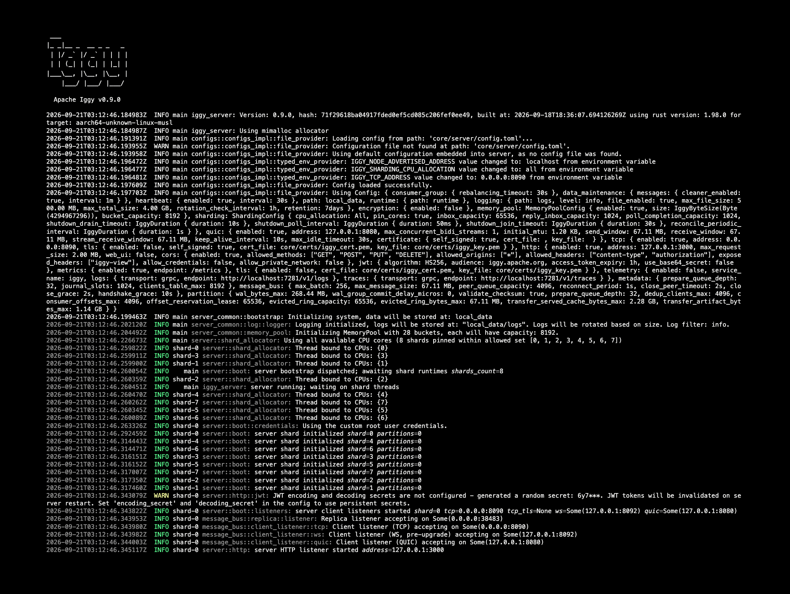
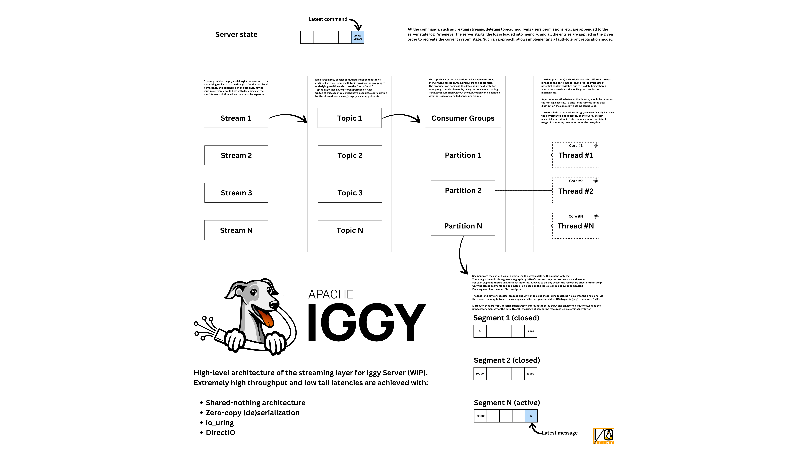

# Apache Iggy Server

The core server component of Apache Iggy: a persistent, append-only log for message streaming. It runs thread-per-core and shared-nothing on `io_uring` (through `compio`), and commits every write through Viewstamped Replication (VSR), so the same binary serves a standalone node and a multi-node cluster.

Clients connect over TCP (custom binary protocol), QUIC, WebSocket, or the HTTP REST API.

## Running

```sh
IGGY_ROOT_USERNAME=iggy IGGY_ROOT_PASSWORD=... cargo run --bin iggy-server --release
```

The leader needs `IGGY_ROOT_USERNAME` and `IGGY_ROOT_PASSWORD` to create root. For local development, `--with-default-root-credentials` sets both to `iggy`. The leader records root in the metadata journal and replicates the same username and password hash to followers. Restarts recover root without these inputs. The server never generates a root password or writes either credential value to its output or log files.

Missing or empty storage is initialized automatically. Existing incompatible
storage is refused without modification. `--fresh` deletes existing data in
the configured system path and must be an explicit reset, never a restart
default. A new cluster starts automatically when its metadata WAL and
superblock are absent. A node with retained metadata rejoins through recovery.
Loss of a replica's entire metadata directory is outside the automatic recovery
guarantee, including loss on every replica. Empty metadata cannot distinguish a
new cluster from a previously used one. Restore a verified consistent backup
through a validated recovery procedure before restarting erased metadata disks.

The Docker image `apache/iggy:latest` ships the server together with the CLI; the `edge` tag tracks the latest development build.

The image binds every listener to `0.0.0.0` so the container is reachable from outside it. A wildcard bind says which interfaces accept connections, not where a client reaches the server, so the address to publish in cluster metadata has to be supplied and the server refuses to start without it. On a single host with published ports that address is `localhost`:

```sh
docker run -p 3000:3000 -p 8090:8090 \
  -e IGGY_NODE_ADVERTISED_ADDRESS=localhost \
  -e IGGY_ROOT_USERNAME=iggy -e IGGY_ROOT_PASSWORD=... apache/iggy:latest
```

Use the hostname or load balancer address clients actually dial when they are not on the same host. The Helm chart derives it from the Service DNS name.

To run one node of a cluster, pass its replica ID from the `cluster.nodes` roster:

```sh
cargo run --bin iggy-server --release -- --replica-id 0
```

Command-line arguments include `--replica-id`, `--fresh` (`-f`), `--with-default-root-credentials`, and `--list-config-env-vars`. Other settings come from configuration.

## Upgrading

Deploy matching server and SDK releases together. Rolling upgrades and mixed
server versions are unsupported. Partition control frames from older servers
carry incarnation zero and are rejected, so a mixed-version cluster cannot
complete partition view changes. The `IGGY-BOUND-GRANTS-5` storage gate
requires fresh storage and rejects older data directories without modifying them.
Cached replies now preserve a committed-result marker, which older receipts lack.
Partition creation records carry an initial view in each 16-byte assignment,
replacing the 12-byte assignments and single request-wide view in older metadata
WAL entries. This boundary also rejects `IGGY-BOUND-GRANTS-4` directories from
upstream and earlier development builds, unchanged before replay.
No in-place upgrade, storage conversion tool or retained-data migration is
provided. Use an offline cutover with logical re-ingestion:

1. Stop application writes, consumers that advance offsets, and administrative
   changes. While the old cluster is still readable, export the required messages
   with an application-specific reader using its compatible SDK. Record payloads,
   headers and per-partition order, topic policies, permissions, and the intended
   consumer restart positions. Check the export against the source before stopping it.
2. Stop every old replica. Preserve a consistent backup of all metadata, partition
   superblocks, WALs, segments and initialization records, with the old binary and
   configuration. Keep these originals unchanged for rollback.
3. Deploy matching new servers and SDKs with separate, empty storage paths on every
   replica. Recreate the required accounts, permissions, streams, topics and groups,
   then re-ingest through the new SDK. New sessions, receipts, partition incarnations
   and offsets do not continue the old ones. Map consumer progress to the re-ingested
   data or choose an explicit new starting position.
4. Verify the restored configuration, permissions, message counts and contents
   before resuming applications. Rollback uses the old binary and its consistent
   backup; it excludes writes accepted by the new cluster unless reconciled separately.

This procedure copies logical application data. It does not convert old storage
files or recover data that is absent from both the source and its backups.

The server no longer generates a root password when `IGGY_ROOT_USERNAME` and `IGGY_ROOT_PASSWORD` are unset. Supply both variables on every replica before the first cluster start so any promoted node can initialize root. Use `--with-default-root-credentials` only in development. A cluster node without credentials waits for root to be replicated. Once root is persisted, restarts need neither.

Releases up to 0.9 printed a generated password to stdout, and 0.9 also wrote it to the log file. Change any root password that was generated, and delete log files and container logs that still hold it. Snapshots redact that legacy log line.

All data directories from earlier storage formats must be wiped before upgrading. The storage-format check rejects them before metadata replay. There is no in-place upgrade or automatic migration.

After storage-format admission, a checkpoint above op 0 preserves initialized metadata. An empty checkpoint at op 0 does not prove that root exists. Without an initialized checkpoint, startup searches the current-format journal for root creation at op 1 because repair can write operations out of order. A journal with complete entries but no validated root creation is rejected before replay.

The error identifies the journal path and any unexpected op 1 fields. Restore a compatible data directory from this storage format, or use `--fresh` to delete local data. In multi-node clusters, use `--fresh` on at most one replica at a time while the others hold quorum.

The diagnostic snapshot (`POST /snapshot`, the binary `GET_SNAPSHOT_FILE` command, `iggy snapshot`) now requires the `manage_servers` permission. `read_servers` alone is rejected, because the archive carries raw server logs and host diagnostics.

All existing self-issued JWT access and refresh tokens are rejected after this
upgrade. HTTP clients and the web UI must log in again. In
`[[http.jwt.trusted_issuers]]`, replace `user_id` with `username`, naming the
account the issuer may act as. The corresponding environment variable changes
from `IGGY_HTTP_JWT_TRUSTED_ISSUERS_<n>_USER_ID` to
`IGGY_HTTP_JWT_TRUSTED_ISSUERS_<n>_USERNAME`.

Cluster metadata includes `replica_id`. Java's `ClusterNode` record adds a leading
`replicaId` component, changing constructor calls and record patterns. C# callers
must initialize the required `ReplicaId` property. The CLI's cluster metadata list
appends a replica ID column. Swift's `ClusterNode` initializer now requires
`replicaID`. C++'s FFI `ClusterNode`, Rust's `iggy_common::ClusterNode` and
`iggy_binary_protocol::responses::system::ClusterNodeResponse` add the public
`replica_id` field; update aggregate and struct initializers.
Go, Java, Node.js and C# clients use command 105's new
partition routes and refresh on `NotPrimary` (89); use their matching releases.

## Configuration

Settings are read from [config.toml](config.toml), resolved relative to the working directory. Set `IGGY_CONFIG_PATH` to load a different file.

Any single value can be overridden with an `IGGY_`-prefixed environment variable that mirrors the TOML path:

```sh
IGGY_TCP_ADDRESS=127.0.0.1:8090 IGGY_HTTP_ENABLED=false cargo run --bin iggy-server
```

Cluster membership, quorum and replica addressing live under `[cluster]`.

New partition primaries are spread across the configured replicas using each
partition's last observed primary, or its committed initial view before an
observation arrives. Concurrent creates count pending assignments too. Once
readiness probes identify responsive replicas, new primaries are assigned only
to those replicas. Before readiness is known, all configured replicas remain
eligible. After the responsive replica set
has been stable for five seconds, the metadata primary balances existing primary
counts one partition at a time. It confirms the source's committed frontier and
the target's applied history, then grants the move to the source primary. The
source finishes its accepted writes before it requests a persisted consensus
view change.
Recovering partitions are skipped without delaying transfers of other partitions.
Every replica still stores every partition.
Balancing primary counts does not balance bytes, throughput or CPU load. A hot
partition still has one ordering primary.

A create whose namespace is invalid can receive 58 (`TransientNotAccepted`) while
any metadata write is pending, even an unrelated one. Under steady unrelated
traffic its retries can reach the deadline with 58 instead of the namespace
error. A valid create that exceeds its configured capacity with the committed
partitions alone still gets the capacity error. If only the creates in flight
leave no room, it gets 58, and under steady create traffic its retries can reach
the deadline with 58. A personal access token create follows the same rule for
the user's tokens and `max_tokens_per_user`.

### HTTP routing and backpressure

An HTTP client therefore often calls a node that is not the partition primary.
If every node accepts the caller's bearer, that node relays message sends, polls
and consumer offset calls to the primary. This needs identical `http.jwt`
secrets on every node, or `cluster.auth`. Without that key material, these calls
answer a transient 503 with code 58 (`TransientNotAccepted`).

A partition relay carries an HMAC-SHA256 proof over its method, path and query,
route, and expiry. The target still authenticates and authorizes the caller.
The relay key derives from the first configured `http.jwt.encoding_secret` or
`http.jwt.decoding_secret`, otherwise from `cluster.auth.shared_secret`.
Keep that material identical on every node. Rotating the material used for
bearers also changes the relay key, so nodes with different keys refuse each
other's relays. Keep node wall clocks synchronized within a few seconds: a proof
has a 10-second lifetime. Relay numeric fields use unsigned decimal with no
leading zeros, and proof tags use lowercase hexadecimal; noncanonical fields
are refused. Proxies must preserve these internal headers unchanged.

A target refuses a missing, invalid or expired proof with 403. When a node's own
relay proof is refused, that node logs a warning and answers the application with
503, code `relay_refused`, and `Retry-After: 1`. Nothing was admitted by that
attempt. Check shared keys and clocks; this response is not a denial of the
application's permission. SDKs with HTTP transports use their ordinary 503 retry
policy. Rust and Python use their configured retry schedule rather than
`Retry-After`; C# honors its delta value; Java uses Apache HttpClient's ordinary
429/503 retry strategy.

A 503 answer to a write means that nothing was admitted, so the write can be sent
again. A 502 or 504 answer to a write means that its outcome is unknown, and the
write can still commit. The body `id` 57 (`TransientNotCommitted`) or the body
`code`, such as `produce_timeout`, names the cause. Read the state before writing
again, because a resend is a new request that can apply twice. The Rust, C# and
Java SDKs never resend such a write, and the Rust SDK reports it as 57.

Metadata forwards and partition relays share a limit of
128 concurrent forwards per node. New forwards at capacity return 503 `forward_busy` with
`Retry-After: 1`. Metadata forwarding has one 30-second retry budget beginning
before the request body is buffered, so a slow upload leaves less time for
forwarding. Partition requests share a 10-second deadline across their metadata
wait, local attempts, relays and reply waits.

A node sends one metadata-floor read at a time and holds no forward slot for it. The read serves every linearizable read that arrived before it was sent, and the reads that arrive while it is in flight share the next one.

Socket replies use `message_bus.client_queue_capacity` per connection. A reply that cannot enter the non-waiting queue closes that connection, leaving the caller to recover any uncertain operation. Paths that wait for reply space hold their bounded permit until delivery or connection teardown.

A reply that waits longer than `message_bus.client_write_stall_timeout` (30 seconds by default) closes the connection, so a client that stops reading its socket, an administrative one included, holds its queue and request tasks for at most that long.

Requests queued behind the ones a connection runs are capped at 1024 frames and at `message_bus.client_request_queue_bytes_max` (256 MiB by default). A request past either cap gets 58 (`TransientNotAccepted`), unless the queue is empty.

### Metadata freshness and counters

On a multi-replica node, client partition requests require recent metadata quorum
evidence before namespace lookup and authorization. The evidence lasts
`K = cluster.heartbeat_timeout + 3 seconds` (8 seconds by default); expired or
absent evidence yields 58. A primary credits answered probes while ready. A
backup credits only a probe from its current metadata primary whose advertised
commit covers the adopted view's head and is already applied locally. Commit
messages alone do not renew this evidence.

The gate uses elapsed time, so a brief view or role change preserves existing
credit without restarting its lifetime. A restarted node has no credit until
fresh evidence arrives. Single-replica nodes do not require network evidence.
A primary advertises evidence to a backup only after that backup answered its
previous probe. The backup ages the evidence from the arrival of that previous
probe. A delayed probe therefore cannot extend backup credit past K. The one
exception is a primary restart in the same view: a late probe of the old
incarnation can then add its own transit time. The aging costs up to one probe
interval of credit. If the primary stops probing, a backup therefore stops
admitting up to one probe interval before the primary does.
K is a lease, not an instantaneous revocation guarantee.

Message and size counters in stream, topic and system stats (`get_stream`,
`get_topic`, `get_stats` and the list forms) are counted per node. A node that
is not the partition primary learns of a commit from the next prepare or from
the periodic commit broadcast. It counts the message only then. While the
cluster is idle, its counters can lag by up to `cluster.commit_broadcast_interval`.

### Sessions and retry receipts

Protocol 0.11.1 uses client-owned registration proofs and `BindSession` (15) to
share a logical session across connections. Commands 14, 103, 104, 123 and 124 are
retired. Partition routing uses 105, polling uses 100 and offset reads use 120. Disconnecting a
connection does not log out its logical session. Server-observed activity renews
the session lease, and expiry or explicit logout retires it before capacity is
reused.

External group offsets belong to groups managed outside Iggy, such as a Kafka
gateway. They require no Iggy group membership and can exceed the partition's
message-offset range.

The bind proof is an independent session credential. Password changes and PAT
revocation or expiry do not end an established session. Binding checks that the
owner still exists and is active; current permissions still govern each request.
Explicit logout, lease expiry, user deactivation and user deletion end session
access.

If a committed reply is lost and that session ends before the caller proves the
outcome, the operation remains uncertain. Signing in again, including after
reactivation, cannot recover the old session's receipt. Reconcile application
state before submitting a new operation; a fresh send can duplicate the old one.
A result already proved and cached by an SDK remains subject to that SDK's local
outcome-cache lifetime.

Permission revocation alone keeps the session alive. Partition retries check
current permissions before receipt lookup and return 41 (`Unauthorized`) until
a re-grant. A retained operation can then resolve its original receipt under the
same session. Metadata retries may replay that user's own committed cached reply
without checking the revoked permission again; a new metadata mutation still
requires authorization. An uncommitted refusal does not settle an earlier
uncertain attempt.

An explicit SDK sign-in or logout ends earlier calls: an unsent call fails with
40 (`Unauthenticated`), while a possibly applied mutation remains uncertain.
Only SDK-managed recovery can continue an unsent waiting call under a replacement
session. It never replays an uncertain mutation under a new identity. A session
wait reaching its deadline fails with 58, and a refused automatic sign-in fails
with 40. The Rust SDK, and the C++, PHP and Python bindings built on it, log the
refusal as a warning. The other SDKs attach it as the cause of that 40. Recovery
uses the caller's last explicit sign-in, falling back to configured automatic
credentials only before
any explicit sign-in. Logout disables automatic sign-in; consult the SDK's
connect/disconnect contract before opening a new session. Swift reports an
unknown mutation as 57 and has no retained-operation resolver.

Error 5009 (`ConsumerGroupPartitionNotOwned`) names the full 128-bit VSR client
ID. `GetClient` and `GetClients` expose the low 32 bits of a transport connection
ID, which is a different identity. Their client IDs cannot be used to look up the
VSR identity in a 5009 diagnostic.

`clients_table_max` and `dedup_clients_max` nominate immutable limits when the
first operation commits in each metadata or partition group. Recovery and state
transfer preserve those committed limits. Configuration changes affect groups
that have not committed a limit yet; existing groups log a mismatch and retain
their committed capacity. At capacity, new sessions or writers are refused until
ordered retirement releases slots. Live retry protection is never evicted.

HTTP writes using one session and partition serialize through the previous
write's reply or bounded deadline. With `ack=none`, a request returns 202 after
its dispatch, while the next request to that partition waits for the previous
write to settle. Waiters acquire the in-flight permit after the partition gate,
so they do not consume the session's budget for other partitions.

Durability defaults remain `Replicated`, and ordinary SDK sends and explicit
offset writes support the configured policy. Crash-safe send retries require
`Persisted`; crash-safe explicit offset retries require `Persisted` and
`Quorum`. Weaker policies can lose data and receipts on a crash. A retained
receipt still replays its original result, but a lost receipt cannot prevent
another execution. NoAck and internal auto-commit polls retain their weaker
completion contracts.

Auto-commit polls are at-most-once: the owner can advance an offset before the
gateway's final authorization check. If the session ends or permissions are
revoked during that return hop, the response is denied and the batch can be lost.

Topics have an immutable `partition_resize_policy` creation option. The default,
`mutable`, permits partition addition and deletion without a bounded cutover or
per-key ordering across partition layouts. `fixed` rejects both operations with
`PartitionResizeDisabled` (2023). Existing messages stay in their original
partitions. Neither policy prevents retention or deletion of the topic.
Set the option through `TopicCreateOptions::partition_resize_policy`, HTTP's
`options` map, or the CLI's `--set partition_resize_policy=fixed`.

## Upgrade recovery

This release changes protocol and storage formats. Servers and compatible
clients deploy together; mixed versions and rolling upgrades are unsupported.
Peers verify protocol, release and storage-format identity before admission.
Executable packaging does not affect that identity, so stripping or rebuilding
the same compatible release does not by itself prevent a replica from joining.

This checkout uses development protocol 0.11.1. Finalize its version and minimum
before the next stable release. Released `server-0.9.0` uses protocol 0.11.0 and
accepts every 0.11.x patch. An incompatible release therefore needs a new minor
protocol version, such as 0.12.0, for that released server to reject new clients
before decoding their login.

The protocol number is independent of server and SDK package versions. Its
current and minimum values are maintained manually for stable releases. The
client login gate checks the full inclusive range, including patch versions.
Both bounds stay equal unless compatibility with older released protocols is
explicitly supported. Edge builds require matching clients and servers, even
when their protocol numbers match.

An unsupported data directory is refused before WAL scanning or file changes.
Replacing the binary does not migrate old data. Use the offline re-ingestion
procedure above for an upgrade. A recovery from a backup must use a separately
verified, compatible backup; copying a format marker is not a migration.

Within compatible `IGGY-BOUND-GRANTS-5` storage, this release reads superblock
envelope versions 1 and 2 and writes version 2. Legacy 66- and 74-byte consensus
records remain readable. New records atomically retain an adopted view, its
advertised head and exact prepare headers alongside the existing consensus state.
These headers preserve log identity across restart; they do not prove that a
message body is present or safe to acknowledge. Recovery still repairs missing
bodies before serving them.

A binary that only understands version 1 refuses a version-2 slot, even if the
other slot still has version 1. After the first new superblock write, replacing
the binary with an older one is not a supported rollback. Restore a consistent
pre-upgrade backup with its matching binary, or use fresh storage and the logical
re-ingestion procedure. Never remove one slot, edit a version or view, or combine
superblocks from different backups to bypass the refusal. This boundary applies
to both metadata and partition superblocks and does not relax the storage gate.

Partition recovery refuses a superblock whose nonzero `log_view`
is below the partition's committed `created_view`. It also refuses a WAL
certificate with a nonzero `log_view` below that floor. The log names the
superblock directory or the `prepares-{revision}` WAL directory and the
recorded views. The affected partition is tombstoned locally and is not served;
its durable files are preserved.

For a superblock with `log_view` zero, recovery raises `view` to at least
`created_view` without changing `log_view`. The raised view must be persisted
before any view-scoped send, just as when no superblock record exists.

Such state can have been written by older servers, including `server-0.9.0`,
after restarting before the partition's first superblock write. The creation
view was not restored on that path. Raising a nonzero `log_view` during an
upgrade would certify history that the replica may not hold, so the server
does not repair those records automatically.

Partition directories hold a `created.revision` file with the revision that
created the partition. Recovery deletes a directory whose file names an older
revision. The partition then starts empty, as if it had no directory, and in a
cluster the replica copies its data from the other replicas.

A directory that an older server made has no such file. A delete that did not
finish before a restart leaves such a directory on disk, and a later create
with the same stream, topic and partition ids finds it. Recovery then loads the
leftover directory as the new partition. Only a leftover superblock with a
nonzero `log_view` below `created_view` trips the superblock refusal. The WAL
refusal does not apply, because each partition has its own `prepares-{revision}`
WAL directory. Recovery logs `adopting a nonempty partition directory without
created.revision` before adopting such a directory, since it cannot distinguish
a live legacy incarnation from a deleted one.

If recovery logs `falls below committed creation view` or the adoption warning
above, look at the history of the affected topic or partition first. If it was
deleted and created again with the same ids, delete it again, and then create
it again. The delete removes the leftover directory on every replica. It also
removes every message in that topic or partition, so do this only if you can
lose them.

In every other case:

1. Pause writes to the affected partition and stop the affected cluster before
   changing any recovery files. Keep the refusal logs.
2. Preserve a consistent copy of every replica's metadata, partition
   superblocks, WAL directories and segment files together with its configuration.
3. Restore only from a verified consistent backup, or use a separately validated
   recovery procedure based on retained replica history. Confirm that it preserves
   acknowledged writes and agrees with the committed partition creation metadata.

There is no automatic in-place migration for below-floor log certificates. Do not edit
view numbers or delete superblocks or WAL directories to bypass the refusal:
an empty history could then replace committed data during a view change.

Before a partition can serve, initialization publishes its incarnation in
`partition-initialization/<namespace>/created.revision` under the system data
directory. This atomic record remains outside the partition directory, including
after that directory is lost. Preserve it with metadata and partition backups.
Storage format `IGGY-BOUND-GRANTS-5` requires this initialization contract;
older data directories are refused before mutation.

Retirement also writes `retirement.fence` in that external namespace directory
before counting a permanently failed partition as retired. The fence names the
failed incarnation and keeps it offline on subsequent boots, even if its
partition directory is replaced. Healthy partitions and new logins can continue.
If the fence cannot be persisted, the session remains retained and retirement
retries. Temporary teardown tombstones and state transfer do not qualify as
permanent failures.

Partition retirement barriers batch up to 128 ended sessions per commit. Each
session still requires retirement reports covering every allocated partition
from a common replica quorum before metadata releases its registry slot. Segment
deletion does not invalidate those reports; changes to partition incarnations
do. Metadata snapshot format 10 persists that separate revision.

A committed partition that has never initialized on this replica can finish
initialization after a crash, including when all replicas stopped before their
first WAL frontiers were published. An initialized partition with no durable
prepare-WAL frontier remains fenced as missing history. A singleton refuses to
serve it; a replicated partition requires history from a healthy peer. If every
replica lost initialized history, restarting does not clear the fence.

Preserve the files and restore a verified consistent backup or use a validated
recovery procedure. If the partition is independently known to be empty, or its
data may be discarded, delete and recreate it through the metadata API. This
creates a new partition incarnation and removes the old data. Missing files
alone are not evidence that discarding that data is safe. Do not create a WAL
frontier or remove initialization records or recovery fences manually.

## Validation limits

Deterministic simulator evidence applies to its recorded head, seed, plane,
fault settings and enabled oracles. A run that never exercises an acceptance
condition does not prove that condition. In-memory simulator partitions do not
serve file-based partition state transfer; that path requires separate storage
and integration coverage. Simulator convergence alone does not establish
production disk, network or performance behavior.

## Systemd integration

Build with the `systemd` feature to enable readiness and watchdog notifications:

```sh
cargo build --bin iggy-server --release --features systemd
```

The server sends `READY=1` only after every enabled transport is bound and accepting, so a unit ordered after it can dial as soon as it is notified. When the unit sets `WatchdogSec=`, the server pings `WATCHDOG=1` at half that interval. On shutdown it sends `STOPPING=1`, which stops a long drain from counting against the watchdog.




