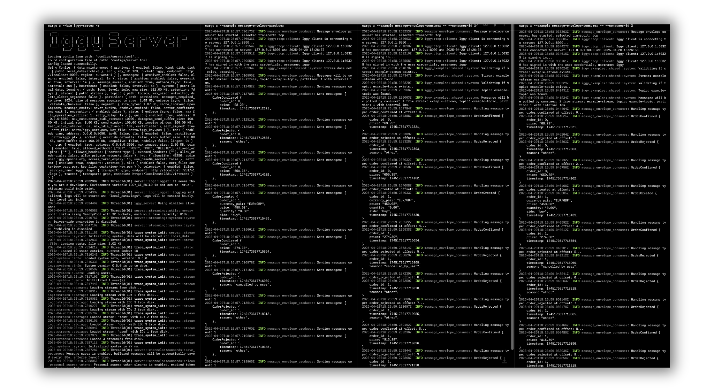

# Iggy Examples

This directory contains a getting-started producer and consumer using the Go SDK over TCP, with optional TLS, a consumer-group reader, a multi-tenant producer and consumer, and a sink data producer. To learn more about building applications with Iggy, please refer to the [getting started](https://iggy.apache.org/docs/introduction/getting-started) guide.

## Running Examples

Use Go 1.25 or newer. The local `go.mod` replaces the SDK dependency with `../../foreign/go`, so build the server from the same checkout. Start it from the repository root, then run the Go commands from `examples/go`.

For disposable development data and no root credential environment overrides:

```bash
cargo run --bin iggy-server -- --fresh --with-default-root-credentials
```

`--fresh` wipes this replica's local data directory. `IGGY_ROOT_USERNAME` and `IGGY_ROOT_PASSWORD` take precedence over the flag. Bootstrap settings do not replace recovered credentials, including credentials recovered from cluster peers. The examples use `iggy`/`iggy` and numeric stream/topic IDs `0`; run the producer first, before creating any other streams or topics.

For server configuration options and help:

```bash
cargo run --bin iggy-server -- --help
```

You can also customize the server using environment variables:

```bash
## Example: Enable HTTP transport and set custom address
IGGY_HTTP_ENABLED=true IGGY_HTTP_ADDRESS=127.0.0.1:3000 cargo run --bin iggy-server -- --with-default-root-credentials
```

The getting-started producer sends 5 batches of 10 messages to partition `0`, and its consumer reads that partition independently and exits after 5 batches; multiple consumers read the same messages and do not join a consumer group.



## Basic Examples

### Getting Started

Perfect introduction for newcomers to Iggy:

```bash
go run ./getting-started/producer/main.go
go run ./getting-started/consumer/main.go
```

### Reader Consumer

Reads the messages of the getting started producer as a member of a consumer group, through a partition reader that waits on the server for new messages and stores the offset of each message once it is processed:

```bash
go run ./getting-started/producer/main.go
go run ./reader-consumer/main.go
```

### Multi-Tenant

Every tenant gets its own stream and its own user, and no user can reach another tenant's stream:

```bash
go run ./multi-tenant/producer/main.go
go run ./multi-tenant/consumer/main.go
```

The producer creates `tenant_<n>_stream` with an `events` topic and a `tenant_<n>_producer` user that may only read and send to that stream, sends messages as each tenant, and then asks for another tenant's stream to show the server refusing it. The consumer adds a read-only `tenant_<n>_consumer` user per tenant, reads every stream as that tenant, and makes the same refused request.

Both read the tenant count from `TENANTS_COUNT` (default `3`). Streams, topics and users are reused when they already exist and their permissions are rewritten, so running either program twice against the same server succeeds instead of panicking.

### Sink Data Producer

Populates an Iggy topic with JSON records so that a sink connector has data to read. The producer sends 100 batches of 100 to 499 records each, logs the total and exits.

Each record contains: `user_id`, `user_type`, `email`, `source`, `state`, `created_at` and `message`. The fields match the Rust and Python sink data producers, so one connector configuration works for every SDK.

Default stream: `qw` | Default topic: `records`

Environment variables:

- `IGGY_STREAM` - stream name (default: `qw`)
- `IGGY_TOPIC` - topic name (default: `records`)
- `IGGY_ADDRESS` - server address (default: `127.0.0.1:8090`)
- `IGGY_USERNAME` - authentication username (default: `iggy`)
- `IGGY_PASSWORD` - authentication password (default: `iggy`)

The producer creates the stream and topic if they are missing and keeps them after it exits, so running it again against the same server succeeds. It addresses the stream and topic by name. On a fresh server, the first stream created takes ID `0`, which the getting-started examples expect, so run this producer after them or on a separate fresh server.

The producer looks up the stream and topic before it creates them. A user without create permission therefore needs read and send permission on an existing stream and topic, like with the Rust and Python producers.

```bash
go run ./sink-data-producer/main.go
```

## TLS Examples

From the repository root, start a disposable TLS server with the development certificate pair and the same credential prerequisites:

```bash
IGGY_TCP_TLS_ENABLED=true \
IGGY_TCP_TLS_CERT_FILE=core/certs/iggy_cert.pem \
IGGY_TCP_TLS_KEY_FILE=core/certs/iggy_key.pem \
cargo run --bin iggy-server -- --fresh --with-default-root-credentials
```

These certificates are for development only. From `examples/go`, run:

```bash
go run ./getting-started/producer/main.go --tcp-server-address localhost:8090 --tls --tls-ca-file ../../core/certs/iggy_ca_cert.pem
go run ./getting-started/consumer/main.go --tcp-server-address localhost:8090 --tls --tls-ca-file ../../core/certs/iggy_ca_cert.pem
```

## Example Structure

All examples can be executed directly from the repository. Follow these steps:

1. **Start the Iggy server**: the Go SDK speaks the VSR wire protocol, so the
   examples need a VSR server.
   Use the source-server command and prerequisites above.
2. **Run the producer, then the consumer**: use the commands above from `examples/go`.
3. **Check source code**: Examples include detailed comments explaining concepts and usage patterns

The getting-started examples use IggyClient with TCP transport and demonstrate automatic stream/topic creation with basic message handling. The multi-tenant example creates its streams and topics explicitly, so that each tenant's user is granted exactly one stream.

The examples are automatically tested via `scripts/run-examples-from-readme.sh --language go` to ensure they remain functional and up-to-date with the latest API changes.
