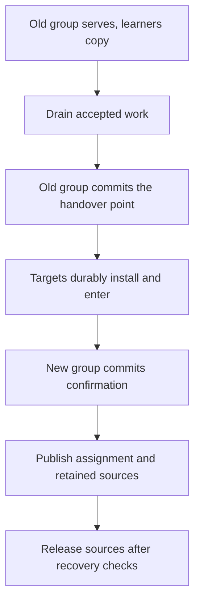

- Feature Name: `horizontal_scaling`
- Start Date: 2026-11-08
- RFC PR: [apache/iggy#4791](https://github.com/apache/iggy/pull/4791)
- Discussion: [apache/iggy#0000](https://github.com/apache/iggy/discussions/0000)
- Iggy Issue: [apache/iggy#0000](https://github.com/apache/iggy/issues/0000)

## Summary

Add scale out, scale in, and node replacement to a running Iggy cluster. New nodes first copy data without voting. Each affected group then changes its replica set through a durable handover, and existing topics keep their replication factors. The same lifecycle gives operators maintenance checks and a basis for supported rolling upgrades. It covers membership, placement, recovery, administration, compatibility, and every SDK, and reuses the current replication and transfer paths.

## Motivation

Consider a three-node cluster whose topics use a replication factor of three. Every node holds a copy of every partition and leads a third of them. Each node's CPU, memory, network, and disk work grows with the whole cluster's load. Adding two machines helps only if Iggy admits them and moves some partition copies and primaries onto them. Copying every partition onto all five machines adds redundancy but not capacity, because every node still serves every partition.

Capacity here means more than disk. A partition's primary handles its produce and poll traffic, replication fan-out, and consumer state, and every replica applies the log and serves recovery. Spreading fixed-factor groups across more machines spreads that work. Tiered storage will move retained data to object storage and ease local disk, but CPU, memory, and network per node still bound how many partitions a node can serve well.

The reverse operation matters too. An operator needs to remove unused nodes, replace a machine before its disk fails, or move work away before maintenance. These actions all need an answer to the same question: when can we stop using the old copy?

Iggy already has per-partition replica sets, rack-aware initial placement, replication flow control, recovery, and state transfer. A five-node cluster can already run topics with a factor of three, with each partition's copies and primary placed across the nodes. What it cannot do is change the set of nodes while running, because the roster and group assignments are static. This proposal adds a controlled way to change them. It does not introduce a second replication system.

I propose keeping membership and compatibility in one RFC because they meet in the same recovery, routing, and durable-state rules. A node can run the same binary as its peers and still be unsafe to admit. Two different binaries can exchange frames and still disagree about how to apply an operation. We need explicit rules for both cases.

Iggy decides when a group can change and when a node can leave. Starting and stopping machines stays with the operator and their deployment tooling.

## Guide-level explanation

### Growing a cluster without raising every topic's replication factor

A replica is one copy of a partition's state. A replication factor of three means that each partition has three voting copies. A larger cluster can spread those copies across more machines.

For example, suppose the original three nodes hold three partitions, A, B, and C. After adding nodes 4 and 5, a valid placement is:

| Partition | Before | After |
| --- | --- | --- |
| A | 1, 2, 3 | 1, 2, 4 |
| B | 1, 2, 3 | 2, 3, 5 |
| C | 1, 2, 3 | 1, 4, 5 |

Each partition still has three copies. Only the selected copies move. The planner also considers partition and primary counts per node, assigned bytes, free space, racks, and the cost of moving data, so this small example is not a balancing policy.

A topic created with an effective factor of three keeps that factor after expansion, including a topic originally configured to use all available nodes. Changing a topic's factor is a separate future operation.

### Joining and moving data

A group is the set of replicas responsible for one partition or for cluster metadata. A learner copies a group without taking part in its decisions. Learner status belongs to a group, not to the whole process. A node can already serve partition A while it learns partition B.

Scale out first admits the nodes and copies cluster metadata to them. Iggy changes the metadata group before moving selected data partitions. That gives the new nodes the cluster information needed to coordinate their assignments.


Existing copies keep serving during the initial transfer. Before responsibility changes, the old group agrees on a final point in its history. The new group must install the required state through that point before it takes over. This RFC calls that point the handover point.

The operation reports progress: affected groups, completed moves, remaining bytes where measurable, and blockers. A node count alone does not mean completion.

### Removing and replacing nodes

Scale in moves a node's partition copies first. Once no data assignment or retained history needs the node, Iggy removes it from metadata membership and the node directory. Only then should the operator remove the machine and its storage.

The remaining cluster must fit every preserved replication factor and placement constraint. A topic with five copies prevents scaling below five nodes. Insufficient free space or a missing required replica blocks the operation, and the response names the affected group.

Replacement adds a new node identity, transfers the old node's responsibilities, and retires the old identity. It needs a free node slot under the existing 32-node limit, which counts learners, plus temporary storage. Without a free slot Iggy refuses the replacement.

A healthy node can supply its state before replacement. A failed node needs enough surviving group state for recovery. A lost sole copy cannot be rebuilt by admitting another empty machine.

### Maintenance and upgrades

Serving readiness and permission to stop a node are different questions. A node can serve its groups while stopping another node would leave one of those groups unable to elect a primary.

Maintenance drains leadership and checks each affected group before the disruption. Topics with one or two copies need separate support for a live move, a restart in place, and recovery after failure. Each advertised path must be tested rather than inferred from overall cluster health.

Rolling upgrades use this maintenance check and a tested compatibility contract between releases. Installing new binaries and activating new behavior are separate steps. The first release with dynamic membership can require a coordinated restart or a migration. This RFC does not promise that every future release can roll.

### Retries and cancellation

Every administrative mutation carries a request identity and an expected version. Retrying the same request returns its existing operation instead of starting another move. Reusing that identity with different parameters is an error.

Cancellation stops work that can still be abandoned safely. Once a group commits its handover point, that transition must finish before a later transition can change the target. Cancellation cannot restore an old configuration by editing a file or deleting the new nodes.

An operation can therefore contain completed, unfinished, and blocked groups. Its status must keep those distinctions after a coordinator restart.

### What changes for contributors

For contributors, the main change is that a group's configuration becomes an explicit value with its own history instead of a fixed roster read at boot. Code that maps a member position to a node, counts a quorum, or compares views must name the configuration it works in.

Desired placement, the configuration a group actually committed, and what a node has observed are three different records, and the sections below keep them apart. Most new code sits beside the existing consensus, transfer, and reconciler paths rather than replacing them.

## Reference-level explanation

### Authority, configuration, and identity

The metadata log owns the node directory and operation plans. Each consensus group owns its actual replica configuration. A metadata plan permits a transition attempt but cannot establish that the group committed it.

The failure model covers process crashes, delayed or duplicated messages, network partitions, and detected storage loss. It does not cover malicious replicas with valid cluster credentials. Authentication binds peers to identities but does not prove that a compromised peer reports truthful state.

The directory records admitted identities, endpoints, racks, maintenance intent, and removal. Desired assignments, actual assignments, and measurements stay distinct. Lag and byte counters are measurements, not membership records.

The implementation keeps these identities separate:

| Identity | Meaning |
| --- | --- |
| Node ID and node incarnation | The routing slot and its admitted storage identity. A process restart preserves the incarnation. |
| Recovery nonce | The existing per-boot value that matches recovery replies to the current process. |
| Partition incarnation | The existing lifetime identifier for delete and recreate. Moving a partition preserves it. |
| Configuration epoch | A monotonically increasing revision of one group's ordered voter set. |
| View | The primary-election revision within a configuration. |
| Connection generation | One installed peer link, including work already queued from that link. |
| Persistence generation | The local writer instance that owns an asynchronous storage completion. |

Reuse `ReplicaSet` for the mapping between group-local member positions and node IDs. A learner has no voting member position. Reordering the same nodes still changes the configuration because it changes the meaning of those positions.

Configuration records keep the ordered members and their incarnations. Historical prepares keep the mapping under which they were created. Epoch and revision increments are checked and refuse overflow.

### Bootstrap, admission, and peer connections

For an existing static cluster, activation records a directory derived from its original roster. It resolves any implicit assignments against that roster and preserves existing partition identities and effective topic factors. Each node must agree on the same bootstrap input.

Fresh cluster bootstrap cannot require committed identity bindings before the initial nodes can communicate. Use a restricted bootstrap and recovery path for the configured initial identities, then bind them through committed metadata. Normal voting traffic remains subject to the resulting configuration.

Dynamic admission binds a new storage incarnation to the cluster, node ID, endpoints, and operation. Public identity and the secret join authorization are different values. A lost admission response must not leave the operation complete but the joining node without its credential.

Extend the existing authentication and identity binding. Preserve the behavior of existing static deployments. The policy for dynamic admission in deployments that run without replica authentication is an open question below.

The message bus follows the committed directory instead of redialing a fixed roster forever. Removed endpoints stop reconnecting. An endpoint change preserves storage identity but replaces the connection generation. Carry the authenticated sender identity and that generation through cross-shard queues and final dispatch.

Bootstrap discovery must also work when a new node has the highest ID. Today the lower ID dials the higher one, so a new node with the highest ID would never be dialed. It needs its own way to contact a seed.

### Learners, transfer, and resource limits

Reuse the existing manifests, checksums, staging, installation, and suffix replay. Materialize only groups named by the current assignment or an authorized incoming assignment.

A learner cannot vote, acknowledge a consensus operation, send an absence report in an election, or become primary after a failed probe. A transfer stage or an untrusted flag does not make a replica a learner. Learner progress can release transport credit but cannot raise a quorum count.

Transferred state includes the retained message data and the state needed to continue the partition: offsets, producer sequences, consumer state, retry receipts, retirement debt, and configuration history. A coherent snapshot plus suffix can represent history whose old message segments were already removed by normal retention.

Pin the snapshot and the required log interval while copying. Retention and deletion must honor those pins or force a coherent restart from a new snapshot. Resuming an operation does not promise that every partially copied byte survives a process crash.

Bound memory, staging disk, open files, bytes in flight, retry rate, and concurrent transfers. Give voting replication and recovery priority. If a destination fills before handover, pause the move and keep its source. Copying converges only when its rate exceeds the growth of the retained data it follows.

### The durable handover

The transition has one immutable identity: group and partition incarnation, old and new configurations, node incarnations, operation revision, handover position, and a checksum of the full record. It also names the designated first primary of the target group.



In the guide example, partition A moves from nodes 1, 2, and 3 to nodes 1, 2, and 4. Node 4 learns A while the old group keeps serving. The old group of nodes 1, 2, and 3 commits the handover point. Nodes 1, 2, and 4 durably record the new configuration and the state through that point, then enter the new group. Node 3 keeps its copy as a retained source until the retirement rule below permits its removal.

Before proposing the handover point, stop new proposals for that group and drain previously accepted work. This includes internal producer and consumer operations. Preserve uncertain client outcomes and their retry identities. A request whose acceptance is unknown cannot be reported as definitely not accepted.

The handover point is an internal operation and consumes no user message offset. Its durable publication covers the predecessor state needed for recovery, whatever the topic's ordinary acknowledgement policy. The old group commits it through the existing consensus algorithm.

Proof that the source committed the handover comes only from that commit path or from validated recovery replay. The record names the exact handover op, both configurations, the operation revision, the source incarnation, and the checkpoint or log state that covers it. A prepared record, an advertised position, or a metadata progress field is not enough.

This record is a statement by an authenticated source under the crash-failure model. It is not a new signature scheme for tolerating malicious replicas. Retained old voters can serve the record after leadership changes. If a primary fails before publishing it, source recovery must establish the same committed record before targets enter.

Once the handover is committed, the old configuration cannot append ordinary or internal operations after it. Enforce this in proposal admission, view adoption, pipeline rebuild, and recovery. A new primary must preserve a committed handover point. An uncommitted proposal can be abandoned only when the old configuration's recovery rules establish that it did not commit.

A target validates the source record and installs the matching state. It publishes the configuration, installed state, and recovery anchor durably before reporting entry. Losing that storage voids the promise and returns the target to non-voting recovery.

Unentered targets are excluded from all target-configuration vote and fallback collections, including empty votes and absence reports. Validate the configuration before collecting a vote or selecting history. A high advertised epoch or view cannot authenticate itself.

The designated primary can attempt a confirmation after the target write quorum has durably entered. The new group commits and persists that confirmation under its own configuration. This establishes progress after entry, but source deletion has a stronger gate below.

### Quorums and permission to delete old copies

Keep the existing write and election quorum functions. They are not interchangeable:

| Group size | Write quorum | Election quorum |
| --- | --- | --- |
| 1 | 1 | 1 |
| 2 | 2 | 2 |
| 3 | 2 | 2 |
| 4 | 2 | 3 |
| 5 | 3 | 3 |
| 7 | 3 | 5 |

For example, three entered members of a seven-member target satisfy its write quorum. If its designated primary fails, those three cannot elect another primary. An administrative retarget cannot create the missing election participants.

The confirmation fixes a recoverable frontier `c`. Permission to retire source copies requires fresh target witnesses with durable state through `c`, not merely through the earlier handover point.

Let `W(n)` and `E(n)` be the existing write and election quorums for a target of size `n`. For a requested additional-failure budget `f`, the proposed initial policy requires:

```text
0 <= f <= min(n - E(n), W(n) - 1)
durable target witnesses through c >= E(n) + f
```

In words, after `f` more crash failures at least an election quorum of the new group still holds durable state through `c`. Every election quorum is more than half of the group, so no election can form without one of those nodes, and the new group can recover `c` without any old copy.

Exclude nodes scheduled for another simultaneous disruption. Evaluate rack or zone failures as sets of lost nodes, not as a scalar count. Detected storage loss removes the affected witness.

This is a conservative source-retirement policy. It is separate from the smaller threshold for starting the new group. Ordinary writes after confirmation keep the existing topic durability contract.

This policy needs the transition model and real-cluster tests described below before it is enabled. A paper's argument for a different quorum structure does not prove it for Iggy's capped write quorum.

### Assignment publication and local cleanup

Before a handover can commit, record the incoming learners and the duty to keep the old sources. When the new group confirms, publish its actual members and the remaining source-retention duties atomically.

The local reconciler keeps the union of current copies, authorized incoming copies, and required old sources. It cannot read departure from the voter set as permission to delete files.

Removal permission names the exact local materialization generation. A delayed cleanup from an earlier move cannot delete a newer copy on the same node. Membership departure also stays separate from the existing fence for logical partition deletion. The same live partition can move away and later return.

A retiring source can serve the committed history needed for transfer while it no longer accepts ordinary requests. Historical repair needs the matching transfer and configuration context. Rejecting all old-configuration traffic would prevent recovery.

### Recovery and failure behavior

Recovery first validates file, cluster, and storage identity. It then reconstructs the committed configuration without voting and checks the durable state against it. It must not derive the expected member count from the same unchecked record it is validating.

Keep the existing refusal of a corrupt published superblock slot. Recovery must not fall back to an older promise when it cannot identify the newer one safely. A transition record without its required application state never authorizes voting.

A fresh incoming learner can need a partition older than its own storage. That is different from an existing voter that lost its only copy. Add an authorized incoming-copy path and keep the refusal to invent lost history.

Every asynchronous completion identifies the exact configuration and state that it wrote. After an await, a successful old write cannot mark the current configuration durable. Install the new immutable group context on its owning shard and rebuild its member-indexed collections together.

| Failure | Required behavior |
| --- | --- |
| Coordinator stops before a handover commits | Resume or cancel the attempt from committed intent and the group's actual state. |
| Source primary stops after commitment | Recover the same committed handover and its record. Do not reopen old-group admission. |
| Target crashes after reporting entry | Recover the promised state from disk. Storage loss removes its voting eligibility. |
| Coordinator stops after target confirmation | Reconcile confirmation and retained sources before publishing completion or authorizing deletion. |
| Old node reconnects after replacement | Reject its retired storage identity and queued old-link work. |
| Partition moves away and returns | Accept the new authorized copy and reject cleanup for its earlier local generation. |
| Required election participants are unavailable | Report the blocked group. Do not force a different configuration from an operation plan. |

### Coordinator, placement, and lifecycle operations

The metadata primary coordinates one cluster-wide scaling operation at a time. Each group has at most one configuration transition. Within that operation, transfers can run concurrently under per-node limits.

For addition, change metadata membership before selected data placements. For removal, evacuate data and release all references before removing metadata membership. The initial design keeps every admitted data node in the metadata group. It does not quietly introduce a separate small controller quorum.

Reuse rack-aware placement and add byte and movement estimates. Finish committed transitions before optional balancing. Pause competing primary balancing for affected groups and avoid repeated moves in response to small load changes.

Create, delete, and retention operations that conflict with the captured topology or transfer state need an explicit gate. Drain prior lifecycle work and preserve source pins. Session cleanup must keep running. A first implementation with a coarse lifecycle gate must expose blocked operations and measure how long the gate holds, which can include a long copy.

Retargeting increments the operation revision. It changes only plans that are still cancellable. A committed group transition must finish before another configuration can replace it.

### Administration and client routing

Expose bounded reads for membership, operations, progress, and maintenance assessment, plus mutations for admission, movement, maintenance, removal, cancellation, and activation. Use the existing server-management authorization.

A mutation carries its request identity, payload, expected directory or configuration version, and intended target. Check for an existing identical request before rejecting a retry for its now-stale expected version. Define result retention and expiry so that an expired retry cannot quietly start a new destructive action.

Read responses distinguish desired, actual, and observed state. Include how fresh the measurements are and name the blockers. Keep large sets of group details bounded instead of returning every partition with each health probe.

Exact command names, numeric allocations, HTTP paths, field layouts, and error representations are settled in the implementation pull requests. This RFC fixes their behavior, not their encoding.

Routes need the partition incarnation, configuration epoch, and view. SDK caches order them in that sequence, while metadata freshness keeps its separate meaning. A newer configuration with view zero must replace an older configuration with a larger view. Moving a partition must not change its incarnation just to reset a cache.

An older route format can stay supported only if a tested translation preserves that ordering. Otherwise the capability negotiation must refuse unsupported clients before dynamic behavior is enabled. Admission considers the cluster's active behavior, not just the binary serving one connection. There is no silent fallback to an older member mapping.

Carry configuration and sender context through forwarded requests, parked polls, delayed acknowledgements, and cross-shard messages. Preserve producer retry identity, consumer ownership, and auto-commit acceptance during handover. A stable bootstrap address does not remove the need to update direct node routes.

### Wire, storage, and release compatibility

Iggy currently documents rolling upgrades and mixed server versions as unsupported, and peers verify protocol, replica wire revision, release, and storage-format identity before admission. This RFC proposes a tested path to change that position for specific release pairs.

Membership identity, replica encoding, installed binary release, accepted client protocol, and stored format are different contracts. Negotiate capabilities in the authenticated handshake and preserve immutable prepare identities across replay and repair.

List every affected header, body, route, snapshot, log, and recovery artifact before changing them. Do not append bytes to a strict existing decoder or remove exact-build rejection before the intended binary pair is tested.

Read supported static state as the initial configuration, using the original ordered roster. Store bounded configuration roots and active transition state. Keep referenced historical configurations outside an unbounded superblock payload.

Configuration-history garbage collection stays disabled at first. Set capacity limits and refuse further transitions before exhausting them. A later compactor needs reference tracking across logs, snapshots, transfers, retry state, and backups.

Migration identifies each source format and validates cluster and resource identity before writing. It stages translated state, makes it durable, publishes it atomically, and keeps the original until the new state opens successfully. Crash recovery must work at each publication step. Membership does not need a new message-segment layout unless the artifact list shows a concrete need.

For rolling upgrades, distinguish compatible encodings from changes to state-machine behavior. A global activation record expresses intent. Semantic changes need ordered barriers in each affected group, with the required replay and storage rules on both sides.

Activation uses fresh capabilities from every required voter, retained source, and authorized target. It is serialized against membership changes and migration. A down node blocks activation unless it leaves through the supported removal process.

Before activation, rollback requires formats and semantics the old binary can still read. After activation, an incompatible old binary refuses the state. Quiet partitions, offline nodes, and backups can keep older artifacts across several releases, so keeping only the previous decoder is not automatically enough.

The first release with this feature requires a coordinated stop unless a tested bridge exists. Classify release pairs as rolling, rolling followed by activation, coordinated restart, or offline migration. Client protocol acceptance is decided separately. Two rolling-compatible servers can still share one client wire version.

### SDKs and implementation order

Rust, Node.js/TypeScript, Go, C#, Java, Swift, Python, C++, and PHP all get the new administration, routing, validation, defaults, errors, retries, and cancellation with the same meaning. Python, C++, and PHP wrap the Rust SDK, but each still exposes the operations in its own API and tests them in its own runtime.

Deployment tooling such as the Helm chart or a Kubernetes operator can start machines and call these operations. It cannot change group membership by counting reachable processes or editing configuration files, and it must not destroy a node's storage before Iggy reports the removal complete.

I plan to implement this in four pull requests:

1. Foundations: the transition model, configuration and recovery context, the directory, and learners, with the Rust SDK changes they need.
2. Safe handover, source retention, the coordinator, placement, scale out, scale in, maintenance, and replacement, with Rust administration and real-cluster tests.
3. Replica compatibility, activation, migration, and tested upgrade pairs, with the matching Rust client behavior.
4. The eight other SDKs and shared BDD scenarios across all nine clients.

The separate [tiered-storage proposal](https://github.com/apache/iggy/discussions/4685) solves a different limit and remains independent. It moves retained data off local disk, while scaling spreads partitions, primaries, and their traffic across more machines, so a cluster can need both.

If tiered storage is active, movement must preserve its committed control state, retained object references, and recovery requirements. The combined case needs its own tests. Neither feature may depend on an unimplemented assumption of the other.

### Validation before release

Use a Rust explicit-state model that calls the production merge, quorum, and suffix-codec code. Check committed history and configuration authority against an independent oracle. The production result cannot be its own correctness test.

Declare bounds for nodes, logs, configurations, views, queued messages, duplicates, crashes, and storage loss. Cover sizes one through five and targeted seven-member cases, with disjoint and overlapping old and new sets. A timeout is an incomplete result.

Removing each safety guard must produce a counterexample. Cover unentered targets in elections, stale configuration history, entry before durable storage, and old-group proposals after handover. Add a two-group coordinator model for partial completion and retargeting.

Turn counterexamples into deterministic simulator regressions on production paths. Exercise stale links, delayed storage completions, primary changes, lost replies, retention, and delete and recreate races.

Real-process and filesystem tests must cover persistence and installation boundaries, disk-full failures, complete target restarts after source deletion, and move-away-and-return cleanup. Mixed-version tests use actual old and new binaries. A simulated capability number does not test binary compatibility.

Run the shared behavior scenarios in every SDK and test the installed packages. Measure normal-traffic overhead, tail latency, interruption time, staging disk, and whether copying catches up under sustained writes. Set performance limits from measured baselines before release.

## Drawbacks

Dynamic membership adds persistent state and more recovery paths to the part of Iggy that must stay correct after failures. The cost is ongoing: every future wire or storage change must account for retained configuration history and supported upgrade pairs.

Copies consume disk, network, and CPU while the source still serves traffic. Conservative retirement holds old storage longer. A transition can stay blocked after commitment when the target loses the participants needed for an election. Safe refusal cannot manufacture availability.

The initial lifecycle gate can delay unrelated administration if its scope is too broad. Keeping metadata membership tied to all admitted nodes also keeps the current wide-group election constraints. More data nodes do not automatically mean a larger failure margin.

Complete SDK support and real mixed-binary testing add release work. The benefit is one defined operating contract instead of compatibility decisions made separately in every deployment.

## Rationale and alternatives

Editing the static roster and restarting is simpler to implement, but does not define how old and new configurations agree on history. It also leaves data placement and safe source deletion to the operator.

Leaving the whole process to an external orchestrator keeps placement policy outside Iggy, but the orchestrator still needs authoritative server operations. Process health cannot show that a configuration committed or that a copy is recoverable. The proposed design gives such tooling those operations.

Copying every partition to every added node increases redundancy instead of spreading a fixed replication factor. Every node still serves every partition, which is the limit described in the motivation.

Joint consensus is a valid alternative to the proposed ordered handover. It needs its own integration with Iggy's quorum functions, recovery, immutable history, and per-partition groups. The handover approach reuses the existing transfer paths, but that practical fit does not replace its proof obligations.

A smaller metadata voter group can improve the operating model of larger deployments. It also adds independent controller placement and failure policy. Keeping the directory separate from group configuration leaves room for that later work without including it here.

Same-binary scaling and rolling compatibility can land at different times. Keeping their contracts in one RFC exposes the shared identity, activation, and recovery decisions early. A release still advertises only the paths its tests establish.

## Prior art

[Viewstamped Replication Revisited](https://pages.cs.wisc.edu/~remzi/Classes/739/Papers/vr-revisited.pdf) describes reconfiguration through an ordered end to an old epoch and entry into a new one. That structure shapes the handover. Iggy's quorum formulas, durable restart, and many independent groups need their own safety argument.

[Kafka KIP-853](https://cwiki.apache.org/confluence/spaces/KAFKA/pages/217391519/KIP-853+KRaft+Controller+Membership+Changes) separates bootstrap discovery from committed voter membership and distinguishes replica identity from its storage incarnation. Those distinctions are useful here. Its Raft-specific transition rules do not establish correctness for Iggy.

[TigerBeetle's upgrade policy](https://docs.tigerbeetle.com/operating/upgrading/) names supported source releases and client versions explicitly. The lesson for this proposal is to test a concrete upgrade path and keep storage and client compatibility explicit. This RFC does not adopt TigerBeetle's migration guarantees or interruption times.

## Unresolved questions

These decisions need closure during RFC review or before the related implementation is enabled:

- Does the full transition model show that every old-group recovery path preserves a committed handover and prevents later old-configuration proposals? This is the main safety gate.
- Which identity-binding policy is required for dynamic admission when a static deployment currently runs without replica authentication?
- Which wire and administration shapes express the proposed contracts, and how are older clients admitted or refused when dynamic routing is active?
- Which existing release formats are supported for initial migration, and which binary pairs support rolling upgrades and rollback?
- What additional-failure budget is offered by default, and how does an operator request rack or zone failure protection?
- How narrow can the first lifecycle gate be, and what resource budgets keep copying convergent without hurting ordinary traffic?

The simulator can explore message ordering, process failures, group transitions, and modeled storage failures. Real filesystems, complete installation paths, SDK runtimes, performance under load, and actual mixed binaries still need integration tests.

Automatic scaling, automatic replacement based only on failure detection, force removal without the required quorum, whole-cluster atomic replacement, changing topic replication factors, standalone-to-cluster conversion, and a wider node-ID space are outside this RFC. They can build on the resulting lifecycle after their own contracts are agreed.
